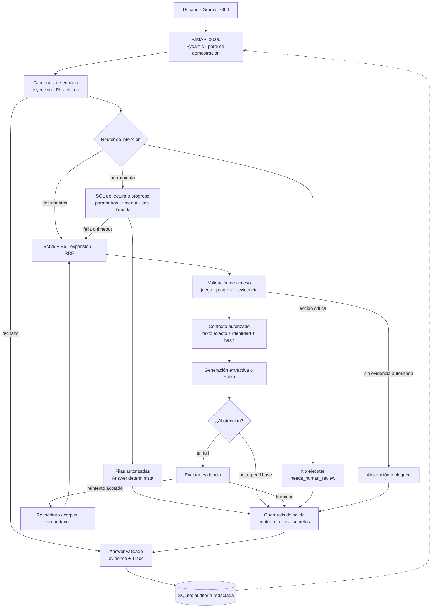
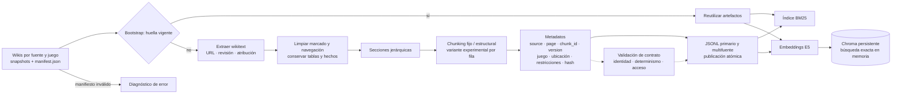

# Arquitectura de GameRAG

GameRAG combina recuperación documental, herramientas deterministas y generación estructurada. El backend comparte un pipeline entre API, pruebas y evaluadores. La interfaz Gradio consume HTTP; las evaluaciones directas del pipeline excluyen el transporte y el renderizado de la interfaz.

## Flujo de usuario

El estado de una consulta contiene pregunta sanitizada, perfil, intención, candidatos, contexto autorizado, decisiones, resultado de herramienta, respuesta y telemetría. En el grafo, el presupuesto de reescrituras evita ciclos abiertos. La herramienta de progreso consulta el perfil y no completa niveles. Un fallo del proveedor puede producir una respuesta extractiva marcada para revisión; esa degradación se registra.

El diagrama representa el modo predeterminado `on_abstain`; el modo opcional `always` evalúa la suficiencia de la evidencia antes de generar, incluso cuando el generador habría respondido afirmativamente. Las herramientas producen respuestas deterministas y no atraviesan el generador ni el evaluador LLM.

## Flujo de ingesta

Cada `page` es el ordinal de la sección de una página wiki, no una página impresa. La revisión documental corresponde al `revid`; la quest de Zelda es una variante del juego y se conserva en otro campo.

## Componentes

| Componente | Implementación | Responsabilidad |
| --- | --- | --- |
| Configuración | `settings.py`, `games.py`, `config/games/` | Perfiles de ejecución, fuentes y progreso |
| Ingesta | `ingest/` | Texto, secciones, chunks y metadatos reproducibles |
| Recuperación | `retrieval/` | BM25, E5, RRF y expansión de consulta |
| Acceso y guardrails | `guardrails/` | Autorización de contexto, entrada y salida |
| Generación | `generation/`, `llm.py` | Contrato, proveedor, caché y presupuestos |
| Orquestación | `pipeline.py`, `graph.py`, `agents/` | Estado y decisiones acotadas |
| Herramientas | `tools/` | SQL parametrizado y progreso de solo lectura |
| Servicio | `api.py`, `store.py` | HTTP, perfiles y auditoría |
| Interfaz | `ui/puesto.py` | Consulta, evidencia, trazas y scorecard |
| Evaluación | `evaluation/`, `eval/` | Bancos, métricas y artefactos comparativos |

## Configuración servida

`base` emplea búsqueda híbrida y generación extractiva. `full` activa el preset de Haiku, grafo, evaluación de evidencia ante abstención y búsqueda secundaria mixta cuando existe una clave no vacía; la aceptación de esa clave por el proveedor es necesaria para generar remotamente. Las opciones explícitas prevalecen sobre el perfil. Planificación y notas derivadas son experimentos opcionales; no constituyen memoria conversacional.

La búsqueda híbrida fusiona posiciones con RRF, no suma scores léxicos y coseno. La profundidad por ranking se mantiene estable al cambiar el número de candidatos pedido por el pipeline. Los [ADRs](decisions/README.md) conservan la comparación de alternativas y los [resultados](../evaluation/results.md) identifican los bancos utilizados.

## Fronteras de confianza

El texto del usuario, las fuentes y la respuesta generada son entradas no confiables. Los filtros se aplican a toda evidencia, incluida la recuperación secundaria y los resultados de herramientas. La API devuelve el contexto final exacto mediante `evidence`; ejecutar otra búsqueda para mostrar citas podría producir documentos distintos. Los perfiles de demostración no acreditan identidad, por lo que los roles locales no sustituyen autenticación para un despliegue público.
