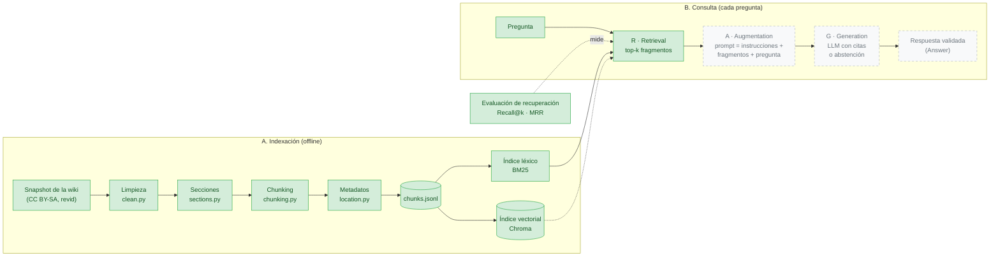

# Arquitectura

Cubre el §6 de [course/instructions.md](../course/instructions.md). El diagrama formal está pendiente (ver la [hoja de ruta](../roadmap.md)).

## Componentes

| Componente | Paquete / archivo | Responsabilidad | Estado |
| --- | --- | --- | --- |
| Configuración global | `src/gamerag/settings.py` | Variables de entorno y `.env`, rutas | ✅ |
| Configuración por juego | `config/games/*.yaml`, `src/gamerag/games.py` | Modelo de progreso, ubicación, herramientas ([ADR-0007](decisions/0007-per-game-config.md)) | ✅ |
| Contrato de salida | `src/gamerag/schemas.py` | Respuesta validada con Pydantic (§11) | ✅ |
| Ingesta | `src/gamerag/ingest/` | Wikitext → chunks con metadatos ([ingestion/](../ingestion/)) | ✅ Línea base |
| Recuperación | `src/gamerag/retrieval/` | BM25, semántica (Chroma) e híbrida RRF ([retrieval/](../retrieval/README.md)); filtros y reranking pendientes | ✅ Tres variantes |
| Evaluación | `src/gamerag/evaluation/` | Banco de pruebas, métricas, ejecución ([evaluation/](../evaluation/)) | ✅ Recuperación |
| Generación | `src/gamerag/generation/` | Contrato `Generator`; extractivo y fallback ([contracts/generation.md](../contracts/generation.md)) | 🟡 Falta Haiku |
| Herramientas | `src/gamerag/tools/` | `query_game_facts`, `next_available_levels`, `update_progress` | ⬜ |
| Guardrails | `src/gamerag/guardrails/` | Contratos `InputGuard`, `AccessFilter`, `OutputGuard`; G1 y citas ([contracts/access-and-guardrails.md](../contracts/access-and-guardrails.md)) | 🟡 Faltan G2-G4, inyección, PII |
| Progreso | `src/gamerag/progress/` | `Profile` con progreso `level_set` / `linear_stage`; perfiles sembrados | ✅ |
| Pipeline | `src/gamerag/pipeline.py` | Une los contratos y produce la `Trace` auditable ([contracts/pipeline.md](../contracts/pipeline.md)) | ✅ |
| API | `src/gamerag/api.py` | FastAPI: backend único que usan la interfaz y el benchmark | ⬜ |
| UI | `ui/app.py` | Streamlit: solo presentación | ⬜ |

## Stack

| Capa | Elección | Motivo |
| --- | --- | --- |
| Entorno | uv (`pyproject.toml` + `uv.lock`) | Instalación reproducible; Docker con caché |
| API | FastAPI | Pydantic nativo, que es el contrato de salida |
| UI | Streamlit 🔶 | Todo en Python; suficiente para la demo |
| Parser de wikitext | mwparserfromhell | Plantillas anidadas ([ADR-0005](decisions/0005-wikitext-cleaning.md)) |
| Índice léxico | rank-bm25 | Línea base; suficiente para unos 1k chunks |
| Índice vectorial | ChromaDB embebido | Sin servidor; filtros `where` para los gates |
| Embeddings | `multilingual-e5-small` | Mejor Recall@5 en la híbrida con chunking estructural ([ADR-0009](decisions/0009-phase3-retrieval-config.md)) |
| Reranker | 🔶 Pendiente | — |
| LLM | Claude Haiku | Router y generación; bajo costo |
| Estado | SQLite en el volumen `state/` | Perfiles, progreso y auditoría ([ADR-0004](decisions/0004-sqlite-and-demo-profiles.md)) |
| Contenedores | docker compose: `api` + `ui` | torch solo CPU; volúmenes `index/`, `models/` y `state/` |

**Recursos objetivo del backend:** 2 GB de RAM o menos. Lo pesado son torch y los modelos, no el corpus ni SQLite. Si hiciera falta recortar, el reranker es lo primero que sale, y eso también sirve como ablación.

## Fases del RAG y estado actual

Un RAG tiene dos momentos. En la **indexación** (offline, una vez) se preparan los documentos. En la **consulta** (cada pregunta) se recuperan los fragmentos relevantes (*Retrieval*), se arma un prompt con ellos (*Augmentation*) y el LLM redacta la respuesta citándolos (*Generation*).



En verde lo implementado y en gris punteado lo pendiente: la *Augmentation* y la *Generation* (paso 3.2, que requiere la API key). Hoy, una pregunta devuelve los fragmentos recuperados (léxica, semántica o híbrida), pero todavía no una respuesta redactada.

## Flujo de consulta

```text
UI (juego, perfil, progreso del juego activo, pregunta)
  -> Guardrails de entrada (esquema, longitud, inyección, PII)
  -> Router de intención (herramientas habilitadas según la config del juego)
       ├─ pregunta del juego    -> búsqueda (gates como pre-filtro) -> rerank -> recheck de permisos -> contexto
       ├─ guía de Level-N/Act N -> ficha padre (small-to-big), recortada a hint_level
       ├─ dato exacto           -> query_game_facts (SQL de solo lectura)
       ├─ "what can I do now?"  -> Zelda: next_available_levels · NG: siguiente etapa
       ├─ desbloquear / + pista -> update_progress (requiere confirmación humana)
       └─ fuera de dominio      -> abstención
  -> Generación (Haiku, contexto cerrado, citas obligatorias)
  -> Guardrails de salida (Pydantic, citas ⊆ permitidas, entidades bloqueadas, juego correcto)
  -> Respuesta + traza de auditoría (SQLite)
```

## Flujo de ingesta

```text
Snapshot de la wiki (repo) -> limpieza -> secciones -> chunking -> metadatos -> JSONL -> índices
```

El detalle está en [ingestion/](../ingestion/).

## Línea base y versión mejorada

| | Línea base (fase 2) | Mejorada (fase 3) |
| --- | --- | --- |
| Chunking | Fijo: 225 palabras, solapamiento de 30 | Estructural por sección + fichas |
| Recuperación | BM25, top-5 | Híbrida (BM25 + vectorial, RRF) + rerank + MMR |
| Gates | Ninguno, a propósito | G1 a G4 ([access-control.md](access-control.md)) |
| Router y herramientas | No | Sí |

La línea base no tiene gates para poder **medir** cuánto spoiler y cuánta mezcla entre juegos y quests se produce sin control.

## Herramientas

| Herramienta | Juegos | Justificación | Límites |
| --- | --- | --- | --- |
| `search_documents` | Ambos | Texto no estructurado | top-k ≤ 10; gates obligatorios |
| `query_game_facts` | Ambos (fuerte en Zelda) | Datos exactos que un LLM suele inventar | Solo lectura, lista blanca, parametrizada, máximo 3 por request |
| `next_available_levels` | Solo Zelda | Razonamiento determinista sobre el grafo de prerrequisitos | Responde qué mazmorras, no cómo resolverlas; la config lo impide en NG |
| `update_progress` / `raise_hint_level` | Ambos | Desbloquear es irreversible, así que es una acción crítica | Requiere `confirm=true` en un request posterior del usuario |
