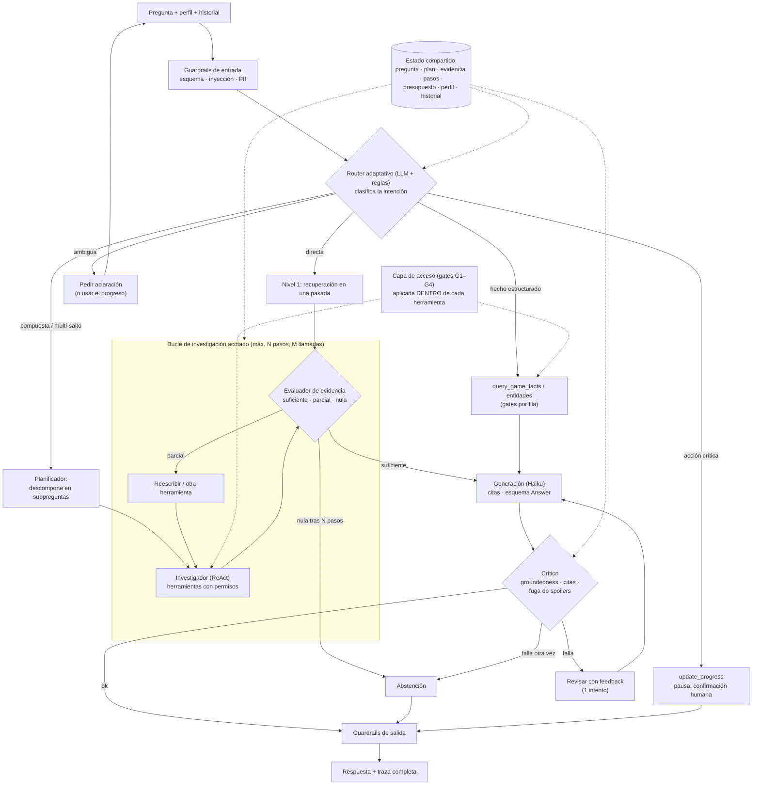

# ¿Es agéntico el RAG actual? Diagnóstico y arquitectura propuesta

Fecha: 2026-11-07. Complementa [arquitecturas-rag-y-contribucion.md](arquitecturas-rag-y-contribucion.md) e [informe-estado.md](informe-estado.md). Basado en `pipeline.py`, `tools/router.py` y los requisitos de [course/instructions.md](course/instructions.md) (§1, §3, §5.6, §6, §8, §14).

> Las referencias de literatura están citadas de memoria; verificar antes de usarlas en un documento o paper.

## 1. Veredicto corto

| Pregunta | Respuesta |
| --- | --- |
| ¿Cumple la letra del §5.6 del curso? | **Sí, de forma mínima.** El §5.6 exige "al menos una" de tres opciones: herramienta externa, flujo de decisión (enrutamiento condicional) o agente autónomo. Hoy hay una herramienta (SQL de solo lectura) y enrutamiento condicional |
| ¿Es un RAG agéntico en el sentido de la literatura? | **No.** Es un *workflow* determinista: un router de expresiones regulares y una sola pasada de recuperación |
| ¿Los "roles" lo hacen agéntico? | **No.** Los roles de hoy (`admin`, `completionist`…) son roles de **acceso** del usuario, no roles de **agente**. Son control de acceso, no agencia |
| ¿Es suficiente para la rúbrica? | Probablemente da puntos, pero queda en el rango bajo de "Herramientas y orquestación agéntica" (10 pts) y es débil frente a lo que dice el §1: *"no basta con conectar un modelo de lenguaje a una interfaz y llamarlo agente"* y §5.6: *"No se aceptan agentes sin justificación funcional"* |

**Qué distingue un RAG de un RAG agéntico.** En un RAG (incluso uno avanzado), el código decide qué se recupera y cuándo, una vez. En un RAG agéntico, un **bucle de control** (normalmente un LLM) decide *si* recuperar, *qué* buscar, *con qué herramienta*, **observa el resultado, lo evalúa y decide el siguiente paso** (reintentar, descomponer, usar otra herramienta, preguntar, abstenerse), con **estado** que persiste entre pasos y **límites** explícitos. Los cuatro rasgos que se suelen exigir son: decisión dinámica, múltiples herramientas, ciclo observar-decidir-actuar, y estado/memoria.

### Contra esos cuatro rasgos

| Rasgo | Hoy | Evidencia en el código |
| --- | --- | --- |
| Decisión dinámica de qué hacer | ⚠️ Reglas fijas | `Router.route` usa regex (`_BOSS`, `_PROGRESS`, `_UPDATE`). Solo reconoce frases que alguien anticipó |
| Varias herramientas | ⚠️ Pocas y estrechas | `query_game_facts` solo consulta la tabla de jefes; `next_available_levels` solo Zelda; `update_progress` no ejecuta |
| Ciclo observar-decidir-actuar | ❌ No existe | `Pipeline.ask` es lineal: guards → router → recuperar → filtrar → generar → guards. Ningún paso mira el resultado del anterior para cambiar de plan |
| Estado entre pasos | ⚠️ Solo registro | `Trace` es un log para auditoría; no alimenta decisiones. El estado persistente (progreso del jugador) existe, pero no hay estado de la tarea (plan, evidencia acumulada, presupuesto) |

Lo que **sí** está bien y se conserva: degradación controlada (herramienta falla → RAG), confirmación humana para acciones críticas, gates por fila en la herramienta SQL, traza auditable, parámetros validados. Son justo los controles que un agente necesita.

## 2. En qué estamos fallando (con evidencia medida)

Cada fila es un fallo ya medido en `docs/evaluation/results.md`, y el componente agéntico que lo corregiría. Esta es la **justificación funcional** que pide el §5.6: ningún componente entra sin un fallo que lo motive.

| # | Fallo medido | Causa raíz | Componente que lo ataca | Tipo |
| --- | --- | --- | --- | --- |
| F1 | NG "how do i heal?": evidencia en rank 11 | Dilución de embedding (chunk mezcla 5 ítems) | Indexación contextual + **reintento con reescritura** si el evaluador juzga la evidencia insuficiente | Indexación + CRAG |
| F2 | "list all the bosses in the first quest": la lista está repartida en varios chunks | Una sola pasada recupera solo una parte | **Herramienta de entidades** o **descomposición + recuperación múltiple** | Herramienta / Plan-and-execute |
| F3 | "dungeon 3": salen primero las páginas de la Quest 2 | La pregunta no dice la quest | El agente **consulta el progreso del jugador** y acota la búsqueda (hoy lo resolvería el gate G2 por detrás) | Herramienta de estado |
| F4 | "where is level 1?": el mapa dice "first dungeon" | Vocabulario distinto; la respuesta está en otra página | **Multi-salto**: primero identificar la mazmorra, luego buscar su ubicación en el mapa | Iterativo (IRCoT) |
| F5 | La abstención no se puede decidir con scores (distribuciones superpuestas) | Los scores de recuperación no miden suficiencia | **Evaluador de evidencia** (LLM) antes de generar | CRAG / Self-RAG |
| F6 | Glosario manual por juego ("attack" → "swing the sword") | No escala; se escribió viendo los fallos | **Reescritura de consulta con LLM**, con el glosario como respaldo | Query transformation |
| F7 | Preguntas compuestas ("boss de level 1 y cómo vencerlo") | Una consulta no cubre dos intenciones | **Descomposición** en subpreguntas | Plan-and-execute |
| F8 | Router por regex: no entiende "who do I fight in dungeon 3?" ni paráfrasis | Reglas rígidas | **Clasificador de intención con LLM** (con reglas como red de seguridad en acciones críticas) | Adaptive-RAG |
| F9 | Un solo turno | Sin memoria conversacional | **Memoria de sesión** y reformulación con historial | Estado |
| F10 | Respuesta extractiva, sin generación | Falta Haiku | Generador con salida estructurada | Base |

## 3. Opciones de arquitectura

| Opción | Idea | Referencias | Ventaja | Riesgo |
| --- | --- | --- | --- | --- |
| **A. Workflow adaptativo + corrector** | Grafo fijo de nodos; el LLM decide en puntos concretos (enrutar, evaluar evidencia, reescribir). Bucles acotados | Adaptive-RAG, CRAG, Self-RAG | Predecible, barato, fácil de auditar y de poner en el diagrama del §6 | Es "agentico ligero": decide poco |
| **B. Agente ReAct con herramientas** | Un LLM razona y llama herramientas en bucle hasta responder | ReAct (Yao et al., 2022); tool use nativo de Claude | Verdadera agencia; maneja multi-salto y herramientas variadas | Costo y latencia variables; más superficie de ataque; difícil de reproducir |
| **C. Plan-and-execute** | Un planificador descompone en pasos; ejecutores resuelven; un sintetizador une | Self-Ask, Plan-and-Solve, LLMCompiler | Bueno para preguntas compuestas y paralelizable | Un plan malo arrastra todo; poco útil en preguntas simples |
| **D. Multiagente** | Varios agentes con roles (planificador, investigador, crítico) | Sistemas de investigación multiagente; AutoGen/CrewAI | Atractivo conceptualmente; separa responsabilidades | Mucho más costoso en tokens; difícil de justificar con 2 juegos y ~700 chunks |
| **E. Búsqueda agéntica sin vectores** | El agente navega páginas/secciones con búsqueda léxica iterativa | Práctica de asistentes de código | Muy fuerte en corpus pequeños y estructurados | Más pasos por pregunta |

**Principio de diseño (de la guía de Anthropic "Building effective agents", 2024):** empezar por *workflows* simples y agregar autonomía **solo donde se demuestra que ayuda**. Eso coincide con el criterio del curso de justificación funcional.

## 4. Arquitectura recomendada: "Escalera agéntica con compuertas"

Una mezcla de A + B + C con un crítico, orquestada como **máquina de estados**. La idea clave: **la mayoría de las preguntas siguen un camino barato; solo las difíciles escalan a comportamiento agéntico.** Eso controla costo y latencia y permite medir cada nivel.

### 4.1 Piezas y de dónde vienen

| Pieza | Qué hace | Origen / referencia | Reutiliza del código actual |
| --- | --- | --- | --- |
| Router adaptativo | Clasifica: directa, estructurada, compuesta, ambigua, acción | Adaptive-RAG | `Router` actual como respaldo y para acciones críticas |
| Planificador | Descompone preguntas compuestas y multi-salto | Self-Ask, IRCoT, Plan-and-execute | — |
| Investigador | Bucle de herramientas con tool use de Claude | ReAct | `Retriever`, `GameFacts` convertidos en herramientas |
| Evaluador de evidencia | Juzga si el contexto responde la pregunta (suficiente/parcial/nula) | CRAG, Self-RAG | Resuelve F5 (abstención) |
| Reescritura | Reformula con el vocabulario de la wiki | Rewrite-Retrieve-Read, HyDE | `query_expansion` como respaldo |
| Crítico | Verifica que cada afirmación tenga cita y que no se filtre contenido bloqueado | Reflexion, LLM-as-judge | `CitationGuard`, `GameFilter` |
| Memoria | Historial de sesión; progreso del jugador (cambios con confirmación) | — | `Profile`, `progress/` |
| Capa de acceso | Gates dentro de cada herramienta, no en el prompt | Diseño por capacidades | `AccessFilter`, gates por fila de la herramienta SQL |
| Traza | Cada paso, herramienta, decisión, tokens y bloqueo | — | `Trace` (ampliar con pasos del bucle) |

### 4.2 Herramientas que el agente tendría

| Herramienta | Qué hace | Estado |
| --- | --- | --- |
| `search_documents(query, filters)` | Recuperación híbrida; **solo devuelve lo permitido** | Existe (hay que exponerla como herramienta) |
| `query_game_facts(table, params)` | SQL parametrizado de solo lectura | Existe (ampliar a ítems, enemigos, ubicaciones) |
| `get_progress()` | Progreso del jugador (nivel, quest) | Existe como `next_available_levels` |
| `read_section(page, section)` | Leer una sección completa de una página permitida | Nueva (navegación al estilo búsqueda agéntica) |
| `list_sections(page)` | Ver el índice de una página permitida | Nueva |
| `update_progress(...)` | Cambiar el progreso | Existe; **siempre pausa para confirmación humana** |
| `ask_clarification(question)` | Pedir al usuario que precise | Nueva |

### 4.3 Seguridad del agente (es lo que lo hace una contribución)

Un bucle agéntico **agrega superficie de ataque** que el RAG de una pasada no tiene:

1. **Fuga por iteración:** el agente puede sondear ("¿existe un jefe en el nivel 9?") y deducir contenido bloqueado por las respuestas.
2. **Fuga por el razonamiento:** el texto intermedio del agente puede repetir contenido que el crítico luego quita de la respuesta, pero ya quedó en la traza.
3. **Fuga por los metadatos:** el mensaje "hay N resultados ocultos" ya revela que existen.
4. **Inyección indirecta:** un chunk de la wiki con instrucciones que el agente podría seguir al leerlo.
5. **Abuso de herramientas:** llamadas excesivas o parámetros fuera de rango; `update_progress` sin confirmación.

**Mitigaciones de diseño:**
- **El control de acceso vive en la capa de herramientas, no en el prompt.** El agente nunca recibe contenido bloqueado, así que no puede filtrarlo aunque lo intente. Es un modelo de *capacidades*.
- Presupuestos duros: máximo de pasos, de llamadas por herramienta y de tokens; tiempo límite por paso.
- Contexto recuperado delimitado como datos (`format_context` ya lo hace) y clasificador de inyección en la entrada y sobre los chunks.
- `update_progress` como pausa de *human-in-the-loop* en el grafo (no es una instrucción del prompt, es un nodo que detiene la ejecución).
- Traza sin PII y sin contenido bloqueado.

Medirlo es lo que convierte esto en aporte: ver sección 6.

## 5. Cómo cumple con el curso

| Requisito | Cómo lo cumple la arquitectura |
| --- | --- |
| §5.6 (al menos una opción) | Cubre las **tres**: herramienta externa (SQL), flujo de decisión (router adaptativo) y agente acotado (investigador ReAct), con justificación por fallo medido |
| §3 "flujo con estado, reglas y límites" | Estado compartido explícito (grafo), reglas (gates, confirmación), límites (presupuestos) |
| §6 diagrama de flujo de usuario | Sigue el orden pedido: guardrails de entrada → router → recuperación/herramienta/agente → validación de permisos → evidencia → generación → guardrails de salida → trazabilidad. El diagrama de la sección 4 se exporta casi directo del grafo |
| §8 casos de herramientas | Ejecución nominal, selección errónea, parámetros fuera de rango, confirmación humana, degradación ante indisponibilidad: ya hay tests; se amplían a las nuevas herramientas |
| §9 operación | El bucle genera pasos, tokens y latencia por nodo: justo las métricas pedidas (P95, tokens, invocaciones, costo) |
| §10 seguridad | Cubre inyección (directa e indirecta), evasión de permisos, acciones críticas, alucinación forzada |
| §14 rúbrica | Herramientas y orquestación (10), Seguridad (15), Arquitectura (15), Trazabilidad (5) |

## 6. Cómo se vuelve una contribución

Se actualiza el plan de ablaciones con una **escalera de autonomía**: cada nivel se mide contra el anterior.

| Nivel | Configuración | Qué se mide |
| --- | --- | --- |
| L0 | Actual: RAG híbrido, extractivo | Línea base |
| L1 | + Haiku (una pasada) | Efecto de generar |
| L2 | + router LLM + reescritura LLM | F6, F8 |
| L3 | + evaluador de evidencia con reintento (CRAG) | F1, F5 |
| L4 | + investigador ReAct con herramientas | F2, F3, F4 |
| L5 | + planificador para compuestas | F7 |
| L6 | + crítico de salida | Fuga y fidelidad |
| L7 (opcional) | Multiagente real (roles separados con contextos independientes) | ¿Compensa el costo? |

**Métricas por nivel:** Recall@5 y éxito de respuesta; *spoiler leakage* (literal e inferida); sobre-bloqueo; tasa de abstención correcta; pasos, tokens, costo y P95.

**Preguntas de investigación que salen de aquí:**
1. ¿Cuánto mejora la autonomía el éxito de respuesta, y a qué costo en tokens y latencia? ¿Dónde se aplana la curva?
2. ¿Aumenta la autonomía la fuga de contenido restringido (por iteración, razonamiento o metadatos)? ¿Los controles en la capa de herramientas la contienen?
3. ¿En qué tipos de pregunta (directa, lista, multi-salto, compuesta) vale la pena escalar?

**Por qué es defendible:** el hueco combina agencia + permisos que dependen del estado del usuario. En la búsqueda de ayer no encontré trabajo directo sobre esto (no es una revisión sistemática; ver el documento anterior). Los resultados negativos también aportan: si L7 no compensa, eso es un hallazgo.

## 7. Implementación

### 7.1 Orquestación

| Opción | Ventaja | Inconveniente |
| --- | --- | --- |
| **LangGraph** (recomendada) | Grafo de estados explícito, ciclos, *checkpointer*, pausas de humano (`interrupt`), exporta el diagrama a Mermaid | Dependencia grande; curva de aprendizaje |
| PydanticAI | Encaja con los modelos Pydantic ya usados (`Answer`), tipado estricto | Menos orientado a grafos |
| Claude Agent SDK / tool use nativo a mano | Control total, sin framework | Hay que escribir el bucle, el estado y las pausas |
| Máquina de estados propia | Cero dependencias; muy didáctica para el curso | Más código que mantener |

Recomendación: **LangGraph para el grafo + tool use nativo de Claude Haiku en los nodos que deciden.** Las herramientas se definen una vez con esquemas Pydantic y se pueden **exponer también por MCP** casi sin costo extra.

### 7.2 Fases (cada una deja el sistema funcionando y se evalúa contra la anterior)

| Fase | Contenido | Resultado |
| --- | --- | --- |
| 1 | `HaikuGenerator` con salida estructurada, citas y abstención | L1; sistema de extremo a extremo |
| 2 | Envolver el pipeline actual en un grafo de estados, **sin cambiar el comportamiento**; la traza pasa a ser por nodo | Paridad medible con L0/L1; el diagrama sale del grafo |
| 3 | Router LLM + reescritura LLM, con las reglas como respaldo | L2 |
| 4 | Evaluador de evidencia + reintento acotado | L3; abstención correcta |
| 5 | Herramientas de navegación y investigador ReAct con presupuestos | L4 |
| 6 | Planificador y crítico | L5 y L6 |
| 7 | Banco ampliado con casos de agente, de fuga y adversarios | Medición del §9 y §10 |

### 7.3 Costos y límites

- Haiku es barato, pero un bucle multiplica las llamadas. Hay que **presupuestar tokens** (decisión abierta del roadmap) y cachear el prompt del sistema y las definiciones de herramientas.
- Escalera de costo: la mayoría de las preguntas se resuelven en el nivel 1 (una llamada de clasificación y una de generación); el bucle solo corre si el evaluador lo pide.
- Todos los bucles con tope duro (por ejemplo, 4 pasos y 8 llamadas) y salida segura (abstenerse) al agotarlos.

## 8. Decisiones abiertas

1. **¿Cuánta autonomía?** Recomiendo L1–L6 (un agente con crítico, orquestado como grafo). El multiagente real (L7) lo dejaría como experimento opcional, porque el costo es mayor y la justificación funcional es débil con este corpus.
2. **¿LangGraph o máquina de estados propia?** Si el equipo valora cero dependencias y un código más pequeño y explicable, la propia es válida. LangGraph da más rápido las pausas de humano y el diagrama.
3. **Coordinación:** el planificador, el crítico y la seguridad se cruzan con lo asignado a otros integrantes (gates G2–G4, inyección/PII, Haiku). Hay que acordar quién toma qué antes de empezar.
4. **Presupuesto de API:** necesario para el router LLM, el evaluador, la reescritura, el crítico y el juez de evaluación.
5. **Revisar el PDF original:** este análisis usa la transcripción de `docs/course/instructions.md`. Si las instrucciones específicas que vas a leer piden algo adicional (un número mínimo de herramientas, un framework concreto), hay que ajustar la sección 5.
