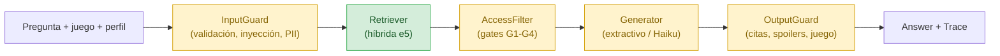

# Contratos entre componentes

El sistema se arma con **interfaces pequeñas**, cada una con una **implementación por defecto que ya funciona**. Así el sistema corre de punta a punta desde el inicio, y cada componente se puede reemplazar sin tocar los demás.

En verde, completo. En amarillo, con una implementación por defecto funcional y pendiente de la versión completa.

| Contrato | Interfaz | Por defecto (ya funciona) | Pendiente | Documento |
| --- | --- | --- | --- | --- |
| Generación | `Generator.generate(question, context, *, game, trace_id) -> Answer` | `ExtractiveGenerator` (sin LLM), `FallbackGenerator` | `HaikuGenerator` | [generation.md](generation.md) |
| Filtros de acceso | `AccessFilter.allows(chunk, profile, game) -> bool` | `GameFilter` (G1) | G2, G2b, G3 y G4 (spoilers) | [access-and-guardrails.md](access-and-guardrails.md) |
| Guardrails de entrada | `InputGuard.check(question, profile) -> GuardResult` | `BasicInputGuard` (vacío, longitud) | Inyección, PII | [access-and-guardrails.md](access-and-guardrails.md) |
| Guardrails de salida | `OutputGuard.check(answer, context, profile) -> GuardResult` | `CitationGuard` (citas ⊆ contexto, juego correcto) | Entidades bloqueadas | [access-and-guardrails.md](access-and-guardrails.md) |
| Pipeline | `Pipeline.ask(question, game, profile) -> (Answer, Trace)` | Une todo lo anterior | — | [pipeline.md](pipeline.md) |

## Datos compartidos

| Dato | Definición | Documento |
| --- | --- | --- |
| `Chunk` | Fragmento con texto, fuente, sección, `revid` y ubicación (`quest`, `level`, `act`, `stage`) | [ingestion/metadata.md](../ingestion/metadata.md) |
| `Hit` | `(rank, score, chunk)`: un resultado de búsqueda | [src/gamerag/retrieval/bm25.py](../../src/gamerag/retrieval/bm25.py) |
| `Profile` | Rol, progreso por juego, `hint_level`; 5 perfiles sembrados en `data/seed/profiles.json` | [access-and-guardrails.md](access-and-guardrails.md) |
| `Answer` | Contrato de salida del §11 | [src/gamerag/schemas.py](../../src/gamerag/schemas.py) |

## Regla para quien implemente un componente

1. Implementar la interfaz en su paquete (`generation/`, `guardrails/`).
2. Agregar tests en `tests/`. Los de [tests/test_contracts.py](../../tests/test_contracts.py) muestran cómo probar cada enganche con dobles de prueba.
3. Conectarlo en `build_pipeline(...)` ([pipeline.py](../../src/gamerag/pipeline.py)), que acepta `generator`, `input_guards`, `access_filters` y `output_guards`.
4. Medirlo: los casos de seguridad y spoilers se agregan al banco ([evaluation/test-bank.md](../evaluation/test-bank.md)).
