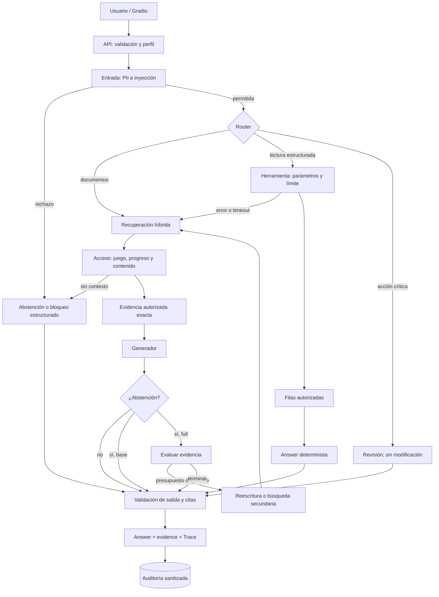
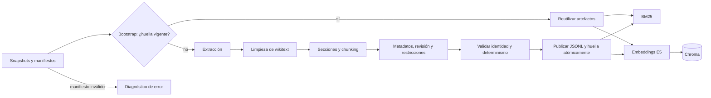

# GameRAG: asistente documental para videojuegos con control de spoilers por progreso

**Informe técnico final — CC3103, Procesamiento de Lenguaje Natural**

**Universidad del Valle de Guatemala — Ciclo 2-2026**

**Docente:** Luis Esturbán

**Integrantes:** Sergio Orellana, 221122; Ricardo Chuy, 221007; Rodrigo Mansilla, 22611.

## 1. Resumen ejecutivo

Desarrollamos GameRAG para responder consultas sobre videojuegos mediante evidencia documental verificable y restricciones asociadas al progreso del jugador. Abordamos una dificultad concreta de las guías extensas: la respuesta buscada suele compartir página con soluciones o eventos que el usuario todavía no desea conocer. Implementamos una ingesta reproducible de snapshots, recuperación híbrida, generación estructurada, herramientas de lectura y trazabilidad de la evidencia utilizada.

Comparamos una línea base BM25 con una configuración que combina embeddings E5, fusión de rankings, expansión de consulta y generación mediante un modelo de lenguaje. En la comparación histórica del 8 de noviembre de 2026 sobre 54 casos, observamos un aumento del indicador de recuperación de 0.7959 a 0.9592 y de la precisión de citas de 0.2653 a 0.7674. En la corrida principal posterior del 9 de noviembre registramos precisión de citas de 0.7708, latencia P95 de 5.733 segundos y sensibilidad de abstención de 0.60 sobre cinco preguntas no respondibles. Conservamos estas cifras con su fecha y configuración; no las atribuimos a una ejecución nueva de las correcciones de cierre.

Reconocemos resultados desiguales entre dimensiones. La recuperación encuentra evidencia con frecuencia, pero persisten contexto irrelevante, citas insuficientes y abstenciones incorrectas. La auditoría también identificó que una página clasificada como general puede contener información posterior al progreso; por ello reforzamos la separación entre acceso al documento, contenido autorizado y evaluación independiente de spoilers. Documentamos los límites de los perfiles de demostración, la ausencia de una revisión humana completa y la necesidad de repetir las mediciones con LLM cuando se disponga de una clave.

## 2. Problema, usuarios y objetivos

Definimos como usuario primario a un jugador que formula una pregunta concreta mientras avanza en un videojuego. Su necesidad consiste en obtener una explicación verificable sin revisar manualmente varias guías ni exponerse a contenido posterior. Consideramos preguntas sobre objetos, mecánicas, ubicaciones y enemigos, así como solicitudes relacionadas con el progreso registrado.

La organización documental introduce dificultades específicas: una misma entidad aparece con nombres alternativos, algunos términos son códigos exactos y una respuesta compuesta puede estar distribuida entre varias secciones. Además, dos recorridos de un mismo juego pueden tener soluciones diferentes. Para distinguirlos preservamos la quest y la ubicación como metadatos del dominio, mientras utilizamos la revisión de la página para identificar su versión documental.

| Perfil | Necesidad | Acceso modelado | Consecuencia de una falla |
| --- | --- | --- | --- |
| Jugador con progreso limitado | Resolver una duda del tramo alcanzado | Juego y ubicaciones alcanzadas | Spoiler o instrucción inaplicable |
| Jugador que acepta spoilers | Consultar toda la evidencia del juego | Perfil `completionist` | Respuesta incorrecta o atribución débil |
| Administrador de demostración | Inspeccionar auditoría y configuración | Perfil local `admin` | Exposición de datos o acción indebida |
| Equipo evaluador | Reproducir decisiones y métricas | Código, bancos y snapshots | Conclusiones no sostenidas por los experimentos |

Nuestra hipótesis es que combinar recuperación léxica y semántica mejora el acceso a evidencia frente a BM25, mientras que el filtrado por perfil y la validación de salida permiten controlar qué información se utiliza. No suponemos que mejorar la recuperación implique automáticamente mejorar fidelidad, abstención o protección de spoilers; evaluamos estas dimensiones por separado.

Nos propusimos construir una ingesta reproducible, comparar alternativas de recuperación, producir respuestas conforme a un contrato, integrar herramientas justificadas y conservar la cadena de decisiones. Adoptamos como metas del proyecto hit rate@5 de al menos 0.80, precisión de citas de al menos 0.90, corrección global y sensibilidad de abstención de al menos 0.90 y latencia P95 inferior a seis segundos en la configuración declarada. Estos umbrales son decisiones de diseño; la guía del curso los distingue de ejemplos orientativos y exige medir otras dimensiones.

## 3. Alcance y criterios de interpretación

Configuramos siete juegos: The Legend of Zelda, Ninja Gaiden (NES), Ocarina of Time, Assassin's Creed II, Doom, Grand Theft Auto: San Andreas y Red Dead Redemption. Concentramos el banco principal y la curaduría inicial en los dos primeros. Utilizamos los demás para estudiar recuperación desde fuentes adicionales y variaciones de estructura; no afirmamos que tengan idéntica cobertura de consultas, etiquetas de progreso o seguridad.

Incluimos consultas principalmente en inglés, recuperación documental, herramientas de solo lectura, API FastAPI, interfaz Gradio y auditoría SQLite. Conservamos un generador extractivo que permite operar sin llamadas de generación remota. Excluimos automatizar la partida, modificar el videojuego, ofrecer autenticación de producción y garantizar soporte equivalente en español. La existencia de embeddings multilingües y algunas reglas en español no constituye una evaluación completa en ese idioma.

Distinguimos implementación, prueba automatizada, evaluación histórica y revisión humana. Una prueba verifica un comportamiento delimitado; una corrida con caché reproduce salidas previamente obtenidas y no mide necesariamente la latencia de una llamada nueva. Asimismo, no interpretamos un marcador sin regresiones como cumplimiento de todas las metas: una referencia histórica puede contener los mismos errores de la versión comparada.

## 4. Corpus, fuentes y gobernanza

Trabajamos con snapshots de wikitext y manifiestos JSON. Cada manifiesto conserva título, URL y `revid` de la página descargada. Los scripts de adquisición y las configuraciones por juego permiten reconstruir el procedimiento, aunque una nueva descarga puede obtener otra revisión. Para repetir los experimentos utilizamos los archivos versionados en el repositorio.

| Familia de fuentes | Uso | Condición registrada |
| --- | --- | --- |
| StrategyWiki | Fuente primaria de los siete juegos | CC BY-SA 4.0 declarada por el sitio |
| Wikipedia | Artículos complementarios por juego | CC BY-SA 4.0 en la configuración |
| Grand Theft Wiki | Contenido específico de GTA: San Andreas | CC BY-SA 3.0 declarada |
| Wikis especializadas de Fandom | Enemigos, personajes y mecánicas | CC BY-SA declarada; versión no siempre precisada |
| Zeldapedia y Zelda Wiki | Fuentes que pueden abarcar la franquicia | GFDL o GFDL 1.3 declarada; separación por fuente |

Conservamos la atribución por página y las declaraciones de licencia en [el inventario del corpus](../../data/wiki_snapshot/README.md) y [la configuración de fuentes](../../config/sources.yaml). No aplicamos la licencia MIT del código a los textos de terceros. Mantenemos separados los materiales con licencias distintas y excluimos manuales comerciales del corpus distribuido.

El corpus no contiene información institucional confidencial. Sin embargo, una consulta puede incluir correo, teléfono o credenciales; por ello redactamos patrones detectables antes de utilizarlos en servicios externos o auditoría. No consideramos ese mecanismo un reconocedor universal de información personal. Configuramos la retención de logs y evitamos distribuir bases locales, cachés o claves con el repositorio.

Para el control de acceso diferenciamos fuente, juego y ubicación. Las fuentes adicionales sin clasificación suficiente se tratan de forma restrictiva para perfiles limitados. El alcance de franquicia se conserva separado y permanece desactivado por defecto en la búsqueda secundaria. Una actualización documental debe reconstruir metadatos e invalidar el índice aunque el contenido textual no cambie.

## 5. Fundamentos y decisiones técnicas

Tomamos como fundamento de RAG la combinación de un generador con acceso a evidencia externa. El trabajo de Lewis et al. estudia esta combinación mediante memoria paramétrica y recuperación documental. En nuestro caso adoptamos el principio de fundamentación, sin reproducir su entrenamiento conjunto ni presentar el uso de un proveedor externo como una réplica del modelo original. [Lewis et al. (2020)](https://arxiv.org/abs/2005.11401).

Utilizamos BM25 como referencia léxica porque permite inspeccionar coincidencias y resolver términos exactos con una implementación ligera. Para representar similitud semántica seleccionamos `multilingual-e5-small`, de 384 dimensiones, y preservamos los prefijos de consulta y pasaje indicados por su ficha. La selección se apoya en los experimentos locales y en la documentación de la familia E5; no inferimos calidad en un juego solo a partir de benchmarks externos. [Wang et al. (2024)](https://arxiv.org/abs/2402.05672), [ficha del modelo](https://huggingface.co/intfloat/multilingual-e5-small).

Fusionamos rankings mediante Reciprocal Rank Fusion: para cada documento sumamos `1 / (60 + posición)` en las listas donde aparece. Esta formulación evita sumar directamente scores BM25 y similitudes coseno, cuyas escalas no son equivalentes. Conservamos una profundidad estable por ranking y un desempate determinista. [Cormack, Clarke y Büttcher (2009)](https://cormack.uwaterloo.ca/cormacksigir09-rrf.pdf).

Consideramos el uso de un evaluador de evidencia como una adaptación limitada de la idea de corregir recuperación insuficiente. CRAG incorpora evaluación de documentos y acciones de recuperación, mientras Self-RAG utiliza entrenamiento y tokens especiales de reflexión. Nuestro sistema no implementa el entrenamiento de Self-RAG ni todos los componentes de CRAG: utilizamos un evaluador por prompt, reescritura acotada y un corpus secundario previamente incorporado. [Yan et al. (2024)](https://arxiv.org/abs/2401.15884), [Asai et al. (2023)](https://arxiv.org/abs/2310.11511).

Representamos el flujo mediante LangGraph cuando el perfil de ejecución lo habilita. Utilizamos estado, nodos y transiciones explícitas para coordinar decisiones; no atribuimos autonomía irrestricta al sistema. Validamos entradas y salidas con modelos Pydantic. La documentación de ambas herramientas respalda estas capacidades, pero los controles de acceso y la semántica de las decisiones son responsabilidad de nuestra implementación. [LangGraph](https://docs.langchain.com/oss/python/langgraph/overview), [Pydantic](https://pydantic.dev/docs/validation/latest/concepts/models/).

Conservamos los experimentos descartados en los ADRs y reportes históricos. El reranker y la segmentación global por filas no demostraron una mejora suficiente en los bancos utilizados. También mantenemos planificación y notas documentales como opciones experimentales desactivadas en la configuración principal.

## 6. Arquitectura del sistema

Organizamos el sistema en dos flujos: preparación documental y atención de consultas. Compartimos el pipeline entre API y evaluadores para reducir divergencias de lógica, pero medimos por separado las capas que cada prueba realmente recorre.

*Figura 1. Flujo de consulta. Las herramientas construyen respuestas deterministas sin pasar por el generador. En `base`, una abstención termina en validación de salida; en `full`, la configuración predeterminada evalúa evidencia ante abstención. El modo opcional `always` evalúa evidencia antes de generar. Todo reintento vuelve a aplicar controles y respeta el límite configurado.*

*Figura 2. Flujo de ingesta. Las revisiones y los metadatos de acceso acompañan al texto hasta la recuperación.*

En `base` utilizamos recuperación híbrida y generación extractiva. El preset `full` requiere una clave no vacía; generar remotamente exige que el proveedor la acepte. Habilitamos grafo, Haiku, evaluación de evidencia y búsqueda secundaria, salvo overrides explícitos. Consultamos `/health` antes de interpretar una demostración o un benchmark.

Persistimos perfiles y auditoría en SQLite; los modelos, índices y chunks se conservan en rutas regenerables. No implementamos memoria conversacional. Las notas opcionales son derivados documentales con procedencia y requieren validar el acceso a sus fuentes; no las equiparamos con recuerdos de interacciones anteriores.

## 7. Implementación de ingesta, recuperación y generación

Extraemos el texto de wikitext y conservamos información útil de tablas, listas y encabezados. Eliminamos marcado y navegación, pero verificamos mediante pruebas que hechos seleccionados sobrevivan a la transformación. Dividimos el contenido en secciones jerárquicas y ofrecemos segmentación fija, estructural y experimental por filas.

La línea base utiliza ventanas de hasta 225 palabras y solapamiento de 30. La variante estructural empaqueta líneas completas, divide por palabras las que exceden el máximo y agrupa segmentos pequeños, con un mínimo habitual de 15 palabras. Estos parámetros no representan una unidad lingüística universal: los elegimos para controlar tamaño de contexto y conservar coherencia en las guías.

Cada chunk incorpora los campos obligatorios `text`, `source`, `page`, `chunk_id` y `version`, además de URL, sección, hash, juego, origen y ubicación. Interpretamos `page` como ordinal de sección dentro de una página wiki. Un identificador estable permite relacionar cita y fragmento, pero necesitamos también revisión y hash para distinguir cambios de contenido o metadatos.

Recuperamos candidatos con BM25 y embeddings, ampliamos consultas mediante glosarios y correcciones controladas y fusionamos las listas con RRF. Solicitamos hasta 50 candidatos para seleccionar hasta cinco fragmentos autorizados; la profundidad interna de cada ranking puede reducir el número efectivo. Conservamos los rangos, scores y causas de bloqueo para diagnosticar si una falla proviene de recuperación, filtrado o generación.

El generador extractivo presenta fragmentos y declara su naturaleza. El generador Haiku recibe contexto delimitado como datos y produce una estructura que validamos. Ante un fallo del proveedor, la alternativa extractiva permite responder bajo revisión; registramos la degradación para que el éxito de la ruta HTTP no oculte el fallo de generación.

Preservamos el contrato académico `Answer`: respuesta, fuentes, abstención, herramienta y revisión humana. Añadimos juego, bloqueo por spoiler e identificador de traza. En la respuesta HTTP incluimos además `evidence`, con el triple de cita, URL, sección, revisión, hash de origen, texto autorizado, indicador de extracto y hash de evidencia. Si restringimos parte de un fragmento, conservamos su identidad y diferenciamos el texto entregado del original.

La interfaz utiliza directamente esa evidencia. Una segunda llamada a búsqueda podría recuperar otro contexto, especialmente después de una reescritura o una recuperación secundaria. Registramos también `final_evidence`, `final_answer`, `llm_calls`, `degradations` y `stages` en la traza para reconstruir lo ocurrido sin repetir la consulta.

## 8. Herramientas y orquestación

Justificamos las herramientas mediante tareas que la recuperación documental por sí sola no resuelve adecuadamente. Una lista completa de jefes puede superar el contexto disponible; el progreso del jugador procede de su perfil y no de una guía. Utilizamos reglas de intención para seleccionar una ruta y limitamos a una herramienta la ejecución por solicitud.

| Ruta | Función | Control |
| --- | --- | --- |
| `query_game_facts` | Consulta estructurada de jefes de Zelda | SQL parametrizado, solo lectura, hasta 50 filas y filtros por fila |
| `next_available_levels` | Niveles completados y pendientes | Lectura del perfil; sin afirmar prerrequisitos jugables |
| `update_progress` | Detectar un reporte de avance | No ejecutar; marcar revisión humana |
| `critical_action` | Detectar borrado, privilegios o desbloqueo | No ejecutar ni modificar estado |
| `documents` | Resolver consultas informativas | Recuperación y generación fundamentada |

Validamos quest y nivel contra la configuración antes de consultar. Ante excepción o timeout de herramienta, degradamos a la ruta documental y preservamos el motivo. El límite temporal reduce la espera de respuesta, pero no constituye un aislamiento de procesos capaz de terminar cualquier trabajo externo.

La indicación `needs_human_review` representa una derivación, no una aprobación realizada. No incorporamos una interfaz completa para confirmar y persistir cambios de progreso. Esta distinción evita presentar como ciclo humano terminado un flujo que únicamente detecta que la acción requiere intervención.

## 9. Metodología de evaluación

Construimos un banco principal histórico de 54 casos con los campos requeridos por el curso. Incluye 39 preguntas de Zelda y 15 de Ninja Gaiden. La distribución por categoría es: 8 directas, 5 paráfrasis, 5 exactas, 4 compuestas, 2 ambiguas, 4 no respondibles, 3 de variante y 23 de robustez. Un caso de robustez también se etiqueta como no respondible, de modo que el denominador de abstención es cinco.

Añadimos un banco difícil de 21 casos, uno de 61 consultas de fuentes adicionales y conjuntos específicos de herramientas y seguridad. No sumamos automáticamente todos estos bancos para afirmar mayor representatividad: sus distribuciones y propósitos difieren. Los conjuntos de desarrollo y los casos ya utilizados para corregir reglas no constituyen muestras independientes.

Distinguimos el hit rate —denominado históricamente Recall@5— del recall de unidades de evidencia esperadas, calculado como `coverage@k`. No lo equiparamos con recall de todos los documentos relevantes. La cobertura E2E utiliza el contexto final, que puede superar cinco fragmentos; no la rotulamos automáticamente como Recall@5. MRR evalúa el primer resultado relevante y el ruido examina el contexto; ninguna de estas medidas certifica por sí sola la respuesta.

Para generación diferenciamos precisión de citas por relevancia, integridad del triple de cita y apoyo factual de las afirmaciones. El apoyo léxico es un indicador diagnóstico sensible a paráfrasis. El juez actualizado recibe pregunta, respuesta y evidencia final exacta, y conserva resultados estructurados de corrección, fidelidad, cobertura y apoyo de citas; su contrato se probó con clientes simulados, sin una nueva evaluación remota. No atribuimos revisión humana a una evaluación automática ni sustituimos el contexto por la respuesta esperada.

Separamos corrección global de abstención y sensibilidad sobre preguntas no respondibles. Reportamos falsos positivos de abstención y respuestas indebidas por separado. En operación distinguimos intentos, llamadas reales, caché, tokens, costo estimado, errores y degradaciones, además de media y P95 de latencia.

Los artefactos de evaluación de esquema 2 incorporan identificador de corrida, huellas del dataset y corpus, configuración efectiva sin secretos, evidencia final y telemetría por solicitud. El parámetro `--serving-profile` identifica `base` o `full`, mientras `--profile` identifica el perfil del jugador. Preservamos los archivos históricos y evitamos comparar silenciosamente métricas de semántica distinta.

Incorporamos la revisión documental como dimensión separada. Cambiar entre First Quest y Second Quest prueba una variante del dominio; cambiar un `revid`, metadatos o contenido y verificar su sustitución prueba actualización del documento. Las pruebas controladas de revisión deben identificarse como sintéticas y no presentarse como modificaciones reales descargadas de una wiki.

La [evaluación de dos revisiones sintéticas con E5 local](../../eval/results/20261116T022250583253Z-b13d858d_versions_synthetic-document-revisions.json) superó ambos casos. Reingestamos la misma fuente en la misma ruta y verificamos cambio de índice, revisión de la cita y sustitución del dato anterior; no añadimos selección temporal a la API.

## 10. Resultados y análisis de fallas

### Comparación histórica sobre el banco principal

Conservamos la comparación del 8 de noviembre de 2026 sobre los mismos 54 casos. El indicador de recuperación se calcula sobre los 49 respondibles y los valores corresponden a los artefactos históricos.

| Configuración | Recuperación histórica | Precisión de citas | Abstención global correcta | P95 (s) | Costo estimado/consulta |
| --- | ---: | ---: | ---: | ---: | ---: |
| BM25 + extractivo | 0.7959 | 0.2653 | 0.9259 | 0.004 | USD 0 |
| Híbrida + extractivo | 0.9592 | 0.3129 | 0.9074 | 0.111 | USD 0 |
| Híbrida + Haiku + grafo | 0.9592 | 0.7674 | 0.9259 | 1.978 | USD 0.000259 |

Observamos que la recuperación híbrida mejora la disponibilidad de evidencia, mientras la generación con LLM mejora la selección de citas frente a la salida extractiva. La precisión de citas permanece por debajo de la meta de 0.90. No interpretamos la diferencia de latencia como una estimación universal del proveedor: depende de caché, equipo, red y configuración de la corrida.

### Corridas históricas posteriores

El manifiesto de scorecard referencia las corridas del 9 de noviembre de 2026. Registramos el modelo configurado como `claude-haiku-5-5`, sin convertir esa etiqueta histórica en una afirmación sobre disponibilidad o precios actuales.

| Medida | Principal | Difícil | Solo fuentes adicionales |
| --- | ---: | ---: | ---: |
| Casos totales / respondibles | 54 / 49 | 21 / 18 | 61 / 61 |
| Recuperación histórica | 0.9592 | 1.0000 | 0.8197 |
| MRR | 0.695 | 0.944 | 0.685 |
| Cobertura de evidencia | 0.9490 | 0.9167 | 0.8197 |
| Ruido / redundancia contextual | 0.747 / 0.100 | 0.778 / 0.107 | 0.836 / 0.080 |
| Precisión de citas | 0.7708 | 0.8611 | 0.7759 |
| Corrección global de abstención | 0.9444 | 1.0000 | 0.9508 |
| Sensibilidad de abstención | 0.6000 | 1.0000 | No aplica |
| Latencia media / P95 (s) | 2.006 / 5.733 | 2.880 / 9.055 | 4.478 / 6.162 |
| Tokens medios | 2712.3 | 3163.1 | 6064.1 |
| Costo estimado/consulta | USD 0.000344 | USD 0.000395 | USD 0.000748 |

Fuentes de estas mediciones: [principal](../../eval/results/2026-11-09_e2e_final-principal.json), [difícil](../../eval/results/2026-11-09_e2e_final-dificil.json), [fuentes adicionales](../../eval/results/2026-11-09_e2e_final-extra.json) y [manifiesto](../../eval/scorecard_manifest.json).

En el banco principal, una corrección global de abstención superior a 0.94 coexiste con sensibilidad de 0.60: solo tres de cinco casos no respondibles producen la abstención esperada. En el conjunto adicional no podemos estimar esa sensibilidad porque todos los casos son respondibles. Además, el P95 supera seis segundos en los bancos difícil y adicional.

Identificamos fallas que requieren lectura del caso. Una pregunta vaga sobre estar atascado obtuvo un consejo general cuando se esperaba abstención o aclaración. Una consulta de Ninja Gaiden recibió una respuesta negativa sobre una mecánica inexistente, lo que puede diferir del indicador booleano sin constituir automáticamente una alucinación. Conservamos estos desacuerdos para revisión semántica, en lugar de convertir toda discrepancia de etiqueta en una afirmación falsa.

En herramientas, el banco de desarrollo alcanzó 26 de 26 casos después de corregir reglas. El segundo banco obtuvo inicialmente 11 de 13; sus dos fallas se corrigieron y posteriormente alcanzó 13 de 13. Desde ese momento dejó de ser un conjunto no visto. Utilizamos el primer resultado como evidencia de generalización limitada y conservamos ambos momentos del experimento.

### Corrida base del cierre previo

Después de corregir los metadatos de quest, ejecutamos 136 consultas con recuperación híbrida y generador extractivo, sin errores de ejecución ni costo LLM. Esta corrida precede a la ampliación de controles sobre celdas de Hyrule; no la atribuimos al código posterior. Conservamos `base` separado de los resultados históricos `full`; no activamos búsqueda secundaria.

| Banco | Casos | Hit rate@5 | Precisión de citas | Abstención global correcta | P95 (s) |
| --- | ---: | ---: | ---: | ---: | ---: |
| Principal | 54 | 0.9388 | 0.3061 | 0.9074 | 0.023 |
| Difícil | 21 | 1.0000 | 0.3704 | 0.8571 | 0.019 |
| Solo fuentes adicionales | 61 | 0.0000 | 0.0000 | 1.0000 | 0.027 |

Vinculamos estas mediciones a los artefactos de esquema 2: [principal](../../eval/results/20261116T022631268527Z-2ffd3153_e2e_audit-final-base-principal.json), [difícil](../../eval/results/20261116T022649868252Z-e9fc6355_e2e_audit-final-base-hard.json) y [fuentes adicionales](../../eval/results/20261116T022651099719Z-d06db1c2_e2e_audit-final-base-extra.json). El caso `zelda_robust_06` perdió su evidencia en top-5 frente a la corrida intermedia, por lo que conservamos también esa regresión. El cero del banco adicional corresponde a evidencia que `base` no incorpora; su corrección de abstención de 1.00 solo indica que respondió todos los casos, sin demostrar respuestas correctas.

En esta corrida extractiva, la sensibilidad de abstención es cero: respondimos indebidamente los cinco casos no respondibles del banco principal y los tres del difícil. El MRR fue 0.690 y 0.944, respectivamente; preservamos denominadores y diagnósticos en el [scorecard base](../evaluation/scorecard-base.md) y comandos de reproducción en la [auditoría de evaluación](../evaluation/audit-current.md).

## 11. Auditoría de seguridad y trazabilidad

Consideramos inyección directa e indirecta, evasión de permisos, acciones críticas, salidas inválidas y afirmaciones sin respaldo. Aplicamos validación Pydantic, detección de patrones, redacción de PII, cuarentena de contenido sospechoso, filtros de acceso y validación de citas. Limitamos las herramientas por configuración, parámetros, tiempo y cantidad de llamadas.

| Amenaza | Componente | Control | Evidencia o limitación |
| --- | --- | --- | --- |
| Inyección del usuario | Entrada | Rechazo de patrones y límites | Suite finita; puede omitir formulaciones nuevas |
| Instrucciones en documentos | Ingesta y contexto | Cuarentena y delimitación como datos | Pruebas controladas de envenenamiento |
| Consulta de contenido posterior | Acceso | Progreso, clasificación y restricción de evidencia | Requiere referencia independiente para fugas indirectas |
| Fuente o página falsificada | Salida | Triple de cita contra contexto | Integridad documental no equivale a fidelidad semántica |
| Cambio de rol o progreso | Router | No ejecución y revisión | Sin aprobación persistente implementada |
| Proveedor no disponible | Generación | Degradación registrada | Respuesta extractiva puede ser menos útil |
| Datos personales en logs | Auditoría | Redacción y retención | Detección basada en patrones, no exhaustiva |

El [artefacto histórico de seguridad del 8 de noviembre](../../eval/results/2026-11-08_security_guarded.json) registra 41 de 42 casos cumplidos, con 16 de 17 en inyección. Sus sondas reportaron cero fugas en 44 consultas de seis juegos y las cinco pruebas de documentos envenenados registraron cero obediencias bajo cuarentena. Conservamos esas cifras vinculadas a su configuración y oráculo originales; el [reporte vigente](../security/report.md) identifica por separado las mediciones posteriores.

Durante la auditoría reprodujimos un límite del oráculo: una consulta sobre Silver Arrows podía recuperar fragmentos de páginas generales que mencionaban contenido del final o tesoros posteriores. Si la métrica de fuga utiliza las mismas etiquetas del filtro, ese contenido puede parecer permitido y no contarse como fuga. Tratamos este hallazgo como un defecto metodológico y de clasificación; incorporamos pruebas independientes del gate y una política conservadora para contenido sin autorización suficientemente definida.

Aplicamos `ContentPolicy` sobre secciones, pasajes y filas, conservando identidad y hash del fragmento original. Las reglas curadas cubren Silver Arrows, tesoros, jefes, quests y desenlaces de Ninja Gaiden. Ampliamos el control a celdas completas de Hyrule y rutas dependientes: conservamos información de White Sword y ocultamos trayectos a mazmorras no autorizadas, incluidos bordes de celda incompletos. La cuarentena distingue revisiones mediante hash y examina notas dirigidas a modelos. No presentamos estas reglas como un clasificador universal ni como pistas graduadas completas.

Conservamos el [oráculo estricto v1](../../eval/results/20261116T021416021518Z-bdb13499_oracle_content-oracle.json), que obtuvo 5 de 8 casos: uno prohibía una mención genérica de Magic Key permitida por la política y dos fallaron por omitir escenas autorizadas presentes en el contexto al recortar la respuesta extractiva. En el [oráculo v2](../../eval/results/20261116T021731134543Z-c9bec733_oracle_content-oracle.json) explicitamos que los nombres generales pueden mostrarse sin asociarlos a una ubicación futura; obtuvimos 7 de 9, con cero fugas observadas y dos fallas de utilidad de Ninja Gaiden. El cambio de expectativa queda visible y no se presenta como mejora medida sobre un banco idéntico.

En la [suite híbrida y extractiva del cierre previo](../../eval/results/20261116T022654688800Z-b171d853_security_guarded.json) superamos 37 de 42 casos, frente a [12 de 42 sin los controles evaluados](../../eval/results/20261116T022700230687Z-c9546ebd_security_baseline.json). Las cinco fallas corresponden a abstención ante preguntas sin respaldo. El oráculo de contenido registra 7/9 y dos fallas de utilidad; el de quests, 2/2 frente a 0/2. En el ensayo separado de envenenamiento, con BM25 y extractivo, la cuarentena evita exponer el canario en los cinco casos; sin cuarentena se expone en 5/5. Estas mediciones preceden al refuerzo de mapas; la última detecta texto copiado, no obediencia de un LLM.

La traza HTTP conserva la pregunta original y `clean_question`, además de intención, filtros, candidatos, contexto final, respuesta y citas. Persistimos la auditoría de `/ask` con redacción; `/search` devuelve su traza sin guardarla. Conservamos llamadas y degradaciones por solicitud. La interfaz muestra la evidencia utilizada, con hashes que distinguen el fragmento original de una proyección autorizada.

Al redactar evidencia en auditoría preservamos revisión y hashes de origen, y registramos `audit_redacted` y `recorded_text_hash` para distinguir el texto persistido. Serializamos la comprobación de presupuesto, llamada y registro entre clientes de un mismo proceso; este control utiliza costos estimados y no garantiza coordinación multiproceso ni la cuota real del proveedor.

Los perfiles locales permiten demostrar reglas de permiso, pero un cliente puede escoger un identificador de demostración. No presentamos ese mecanismo como autenticación ni exponemos su administración como servicio público seguro. La evaluación de acceso se refiere al perfil suministrado bajo las condiciones de la demo.

## 12. Reproducibilidad, limitaciones y trabajo futuro

Fijamos dependencias con `uv.lock` y conservamos snapshots, configuraciones y bancos. El [README](../../README.md) documenta la ejecución. `gamerag.bootstrap` prepara el corpus efectivo, invalida artefactos cuando cambian configuración, snapshots o ingesta y publica archivos atómicamente.

En el cierre previo generamos 2,759 chunks primarios y 10,462 multifuente para siete juegos en catorce conjuntos JSONL. Verificamos un arranque limpio de Docker con ambos corpus, grafo y búsqueda secundaria. Utilizamos el preset `full`, override BM25, clave ficticia inválida y `llm_offline=true`; no atribuimos calidad generativa a esa comprobación sin llamadas remotas.

Conservamos los registros del cierre previo: [489 pruebas sin omisiones](../../eval/results/2026-11-16_pytest-closure.xml), Ruff aprobado y [36 comprobaciones HTTP offline](../../eval/results/2026-11-16_http-closure-offline.json). Tras corregir los mapas superamos 520 pruebas, sin omisiones, y siete comprobaciones HTTP focalizadas, verificadas en consola sin generar otro XML o JSON. No sumamos estas ejecuciones como casos independientes. En Gradio inspeccionamos consulta, citas, Dodongo, búsqueda, scorecard y contraste oscuro; no acreditamos un recorrido completo con teclado o lector de pantalla.

Reconocemos límites de generalización por tamaño y composición de los bancos. Las fuentes adicionales aumentan cobertura a costa de contexto más extenso y clasificación menos uniforme. Los glosarios y el router se ajustaron tras observar fallas, por lo que necesitamos nuevos conjuntos no inspeccionados para estimar desempeño fuera del desarrollo.

Priorizamos ampliar la curaduría de permisos y spoilers, realizar una revisión humana documentada de fidelidad, evaluar herramientas con casos no vistos y ampliar consultas en español. Un despliegue fuera del curso requeriría autenticación, separación de permisos administrativos y un flujo de aprobación explícito para cambios de estado.

Mantenemos [un guion de defensa](defensa.md) con consulta nominal, citas, abstención, herramientas, ataque y diagnóstico de una falla real, sin atribuir un ensayo no registrado. El [proceso de maquetación](README.md) genera un PDF A4 y un manifiesto de hashes, figuras y páginas para comprobar el rango exigido de 10 a 15 páginas.

## 13. Conclusiones

Con los experimentos históricos observamos que la recuperación híbrida mejora el acceso a evidencia frente a la línea base léxica en el banco principal. La mejora no elimina los errores de atribución ni las abstenciones incorrectas: la precisión de citas queda por debajo de la meta adoptada y la sensibilidad ante consultas no respondibles presenta una limitación concreta.

Encontramos que la trazabilidad exige preservar más que identificadores de chunks. Al conservar respuesta, texto autorizado, revisión y hashes podemos examinar el contexto que respaldó una salida, incluso después de reescrituras, proyecciones o cambios del corpus. También identificamos que evaluar spoilers con el mismo criterio utilizado para filtrarlos puede ocultar errores de clasificación.

Delimitamos la contribución como un sistema académico reproducible con recuperación, generación, herramientas y controles verificables. Conservamos los fallos y los experimentos descartados como parte de la evidencia; dejamos pendientes de acreditación la revisión humana completa, las nuevas corridas que requieran proveedor externo y la defensa individual.

## 14. Uso de inteligencia artificial y referencias

### Declaración de uso de IA

Utilizamos Codex y subagentes durante la auditoría, la implementación de correcciones y la elaboración de esta documentación. Su intervención incluyó lectura de código y requisitos, propuesta de pruebas, ajustes técnicos y redacción inicial. Conservamos la responsabilidad de revisar las modificaciones, comprobar los resultados y comprender el sistema para la defensa individual.

El sistema incorpora un modelo Haiku como generador y, en determinadas configuraciones, como evaluador de suficiencia o juez. El repositorio contiene mecanismos de generación sintética de casos y notas documentales experimentales; distinguimos esos productos de anotaciones humanas. No contamos con un registro retrospectivo exhaustivo que permita asignar todas las intervenciones anteriores por persona, fecha o herramienta, y no completamos esos datos mediante inferencias.

Las corridas con caché, los jueces automáticos y las pruebas sintéticas se identifican como tales. No declaramos revisión humana, ejecución nueva del proveedor o ensayo oral cuando solo existe evidencia automatizada o histórica.

### Referencias bibliográficas

1. Lewis, P., et al. (2020). [Retrieval-Augmented Generation for Knowledge-Intensive NLP Tasks](https://arxiv.org/abs/2005.11401). NeurIPS.
2. Cormack, G. V., Clarke, C. L. A., y Büttcher, S. (2009). [Reciprocal Rank Fusion outperforms Condorcet and individual Rank Learning Methods](https://cormack.uwaterloo.ca/cormacksigir09-rrf.pdf). SIGIR.
3. Wang, L., Yang, N., Huang, X., Yang, L., Majumder, R., y Wei, F. (2024). [Multilingual E5 Text Embeddings: A Technical Report](https://arxiv.org/abs/2402.05672).
4. Yan, S.-Q., Gu, J.-C., Zhu, Y., y Ling, Z.-H. (2024). [Corrective Retrieval Augmented Generation](https://arxiv.org/abs/2401.15884).
5. Asai, A., Wu, Z., Wang, Y., Sil, A., y Hajishirzi, H. (2023). [Self-RAG: Learning to Retrieve, Generate, and Critique through Self-Reflection](https://arxiv.org/abs/2310.11511).
6. Intfloat. [Multilingual-e5-small: model card](https://huggingface.co/intfloat/multilingual-e5-small).
7. LangChain. [LangGraph overview](https://docs.langchain.com/oss/python/langgraph/overview).
8. Pydantic. [Models and validation](https://pydantic.dev/docs/validation/latest/concepts/models/).
9. Equipo del proyecto. [Fuentes, licencias y manifiestos](../data/sources.md), [decisiones de arquitectura](../architecture/decisions/README.md), [bancos y métricas](../evaluation/metrics.md).
10. Universidad del Valle de Guatemala. [Instrucciones del proyecto final CC3103](instructions.md) y [presentación del curso](presentation.md).
