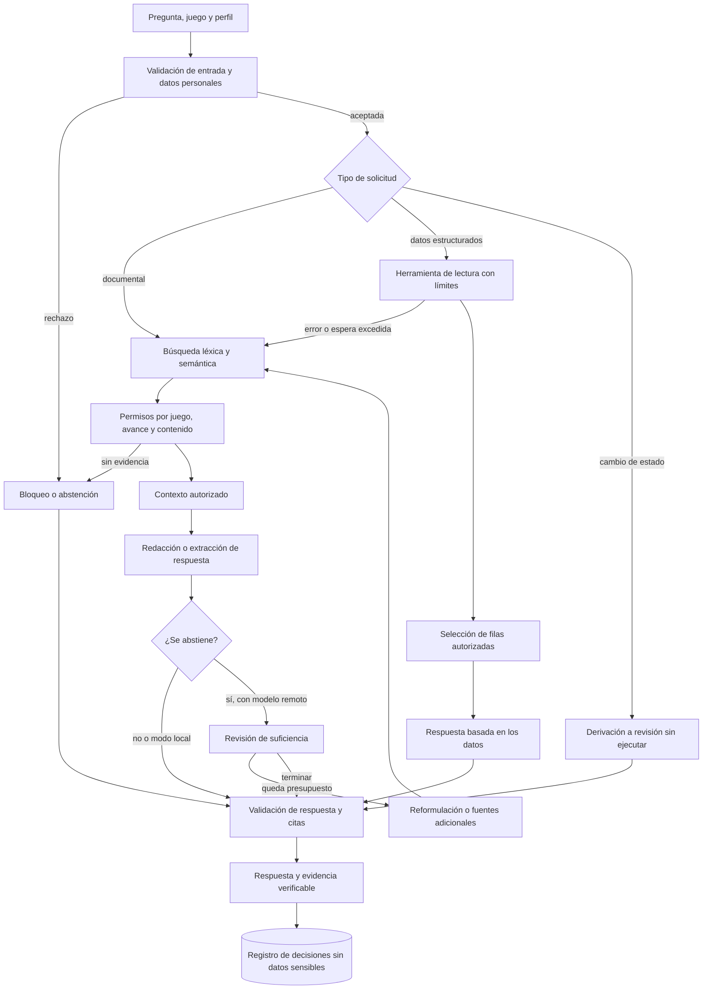
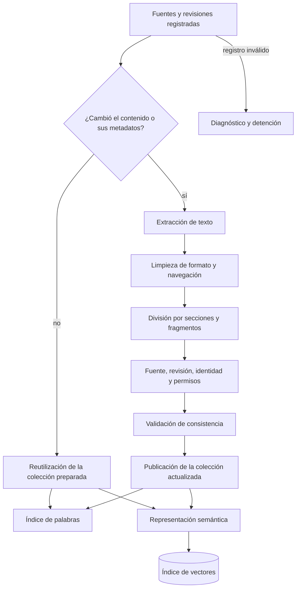

# GameRAG: asistente documental para videojuegos con control de spoilers por progreso

Informe técnico final

Universidad del Valle de Guatemala

Sergio Orellana, 221122

Ricardo Chuy, 221007

Rodrigo Mansilla, 22611

Procesamiento de Lenguaje Natural

Guatemala, 17 de noviembre de 2026

---

## 1. Resumen ejecutivo

Desarrollamos GameRAG para responder preguntas sobre videojuegos con guías verificables y restricciones según el progreso del jugador. Buscamos evitar que una consulta revele soluciones o acontecimientos posteriores. Recuperamos pasajes pertinentes, comprobamos sus permisos y presentamos respuestas con las fuentes utilizadas.

Integramos búsqueda léxica y semántica, generación fundamentada y herramientas de lectura. Incorporamos siete juegos y concentramos la evaluación principal en The Legend of Zelda y Ninja Gaiden. En la comparación inicial sobre 54 preguntas, la recuperación de alguna evidencia pasó de 79.59 % a 95.92 %, y la precisión de citas de 26.53 % a 76.74 %.

En la evaluación generativa posterior del banco principal obtuvimos 77.08 % de precisión de citas y abstención correcta en tres de cinco preguntas no respondibles. Después reforzamos los controles y superamos 520 pruebas automatizadas. Ampliamos el análisis con registros conservados; las mediciones generativas siguen correspondiendo a sus ejecuciones históricas.

Video de presentación del proyecto: [https://youtu.be/ZC5XwdeHOQ4](https://youtu.be/ZC5XwdeHOQ4).

## 2. Problema, usuarios y objetivos

Identificamos como usuario principal a un jugador que necesita resolver una duda durante su partida. Las guías distribuyen información entre objetos, enemigos, mapas y recorridos, con nombres alternativos y variantes de una misma aventura. Su consulta puede revelar soluciones o acontecimientos posteriores al avance del jugador.

Buscamos reducir el tiempo perdido por instrucciones incorrectas y la revelación irreversible de contenido. Definimos la tarea como una respuesta sustentada en documentos del juego seleccionado y compatible con el progreso indicado.

| Perfil de usuario | Necesidad | Acceso previsto | Riesgo principal |
| --- | --- | --- | --- |
| Jugador con avance limitado | Resolver dudas de la etapa alcanzada | Contenido autorizado por su progreso | Revelación de soluciones posteriores |
| Jugador que acepta spoilers | Consultar toda la información disponible | Colección completa del juego | Respuesta incorrecta o poco sustentada |
| Administrador de la demostración | Examinar funcionamiento y registros | Configuración y auditoría local | Uso indebido de datos o permisos |
| Equipo evaluador | Reproducir y explicar resultados | Casos, fuentes y mediciones | Interpretación incorrecta de la evidencia |

Nos propusimos preparar documentos de forma reproducible, comparar recuperadores y responder con citas verificables y herramientas justificadas. Planteamos que combinar palabras y similitud semántica mejoraría la recuperación léxica. Evaluamos por separado la disponibilidad de evidencia y la fidelidad de las respuestas.

Adoptamos como metas recuperar evidencia relevante entre los cinco primeros resultados en al menos 80 % de las consultas respondibles y alcanzar al menos 90 % de precisión de citas, corrección global de abstención y detección de preguntas no respondibles. También fijamos una latencia inferior a seis segundos para el percentil 95. Estos valores representan nuestras metas de diseño y no requisitos numéricos universales del curso.

## 3. Alcance del proyecto

Incluimos The Legend of Zelda, Ninja Gaiden para NES, The Legend of Zelda: Ocarina of Time, Assassin's Creed II, Doom, Grand Theft Auto: San Andreas y Red Dead Redemption. Concentramos la curaduría y la evaluación principal en los dos primeros; con los otros cinco estudiamos la ampliación de fuentes.

Implementamos una interfaz web para seleccionar juego y perfil, consultar guías y examinar evidencia. Incorporamos información estructurada sobre jefes y progreso. Evaluamos principalmente preguntas en inglés; no acreditamos un desempeño equivalente en español por utilizar representaciones multilingües.

Delimitamos el proyecto como un asistente de consulta, sin automatizar la partida. Los perfiles demuestran restricciones, pero carecen de autenticación de producción. Derivamos los cambios de progreso o privilegios a revisión sin ejecutarlos. Excluimos memoria conversacional y pistas graduadas completas.

## 4. Corpus, fuentes y gobernanza

Recopilamos texto con marcado de wiki, denominado wikitext, y metadatos estructurados de procedencia para todas las fuentes. Conservamos título, dirección de origen y número de revisión por página. Los 24 registros de adquisición contienen 1019 entradas, algunas repetidas entre juegos. Preparamos 2759 fragmentos primarios y 10 462 al incorporar fuentes complementarias.

| Fuente | Período de adquisición | Revisiones conservadas | Licencia declarada |
| --- | --- | --- | --- |
| StrategyWiki | Noviembre de 2026 | 273976 a 1205264 | CC BY-SA 4.0 |
| Wikipedia | Noviembre de 2026 | 1368656270 a 1384343898 | CC BY-SA 4.0 |
| Grand Theft Wiki | Noviembre de 2026 | 125933 a 419948 | CC BY-SA 3.0 |
| Wikis de Fandom | Noviembre de 2026 | Numeración independiente por wiki | CC BY-SA, sin versión declarada |
| Zeldapedia | Noviembre de 2026 | 929801 a 1028044 | GFDL |
| Zelda Wiki | Noviembre de 2026 | 1308442 a 1401507 | GFDL 1.3 |

Identificamos el mes de descarga de las fuentes. Conservamos las fechas de adquisición en sus registros, con hora UTC cuando está disponible; el registro inicial carece de hora y zona. Los intervalos numéricos indican revisiones mínima y máxima recopiladas, sin constituir historiales completos. En Fandom preservamos la numeración de cada sitio; por ejemplo, la página de San Andreas conserva la revisión 2084703.

Aplicamos a todas las fuentes una actualización manual por hitos: congelamos sus revisiones durante cada campaña de evaluación y consideramos nuevas descargas antes de otra campaña o ante una corrección relevante. Reconstruimos las representaciones cuando cambia texto, revisión o restricciones. No realizamos sondeos automáticos periódicos.

Conservamos atribución y condiciones por fuente. CC BY-SA corresponde a Creative Commons con atribución y compartir igual; GFDL, a la licencia de documentación libre de GNU. La licencia del código no sustituye estas condiciones. Excluimos manuales comerciales y separamos las fuentes de franquicia. Restringimos contenido sin clasificación suficiente y ocultamos correos, teléfonos y credenciales detectables antes de servicios externos y auditoría, con retención limitada.

## 5. Fundamentos y decisiones técnicas

Adoptamos la generación aumentada por recuperación, conocida como RAG, para fundamentar respuestas en evidencia externa. Seguimos el principio de combinar recuperación documental y generación descrito por Lewis et al. (2020), sin reproducir su entrenamiento conjunto.

Seleccionamos BM25 como referencia léxica por su utilidad ante nombres y términos exactos. Su limitación principal aparece cuando la pregunta y la guía expresan la misma idea con palabras distintas.

Representamos preguntas y pasajes mediante E5 multilingüe en su variante pequeña, con vectores de 384 dimensiones y preparación diferenciada de consultas y documentos (Wang et al., 2024; Intfloat, s. f.). Consideramos su costo operativo y los resultados locales al seleccionarlo.

Combinamos las listas mediante fusión de rangos recíprocos, con constante 60 y desempates estables. Seguimos a Cormack, Clarke y Büttcher (2009) para utilizar posiciones en lugar de sumar puntuaciones léxicas y semánticas de escalas diferentes.

Los trabajos de Yan et al. (2024) y Asai et al. (2023) motivan nuestra revisión de suficiencia documental. Adaptamos esa idea mediante evaluación del contexto, reformulación y búsqueda complementaria acotadas. No entrenamos un modelo de autorreflexión ni reproducimos íntegramente esas propuestas.

Organizamos decisiones mediante estados explícitos y validamos estructuras de entrada y salida (LangChain, s. f.; Pydantic, s. f.). La segunda ordenación con un modelo adicional no justificó su activación predeterminada en los experimentos. Elegimos la segmentación por secciones para respetar la organización de las guías.

## 6. Arquitectura del sistema

Organizamos la arquitectura en un flujo de consulta y otro de preparación documental. Durante la consulta conservamos el juego, el perfil, los candidatos recuperados, la evidencia autorizada y el presupuesto disponible. Cada transición utiliza ese estado para seleccionar una acción y registrar su resultado.

Figura 1. Flujo de consulta. Las herramientas preparan respuestas directamente a partir de datos autorizados. Los intentos adicionales vuelven a aplicar los permisos y respetan los límites configurados.

Figura 2. Flujo de preparación documental. Conservamos la procedencia y las restricciones junto al texto y reconstruimos los índices cuando cambia información relevante para la consulta.

Ofrecemos un modo local de recuperación híbrida y extracción. El modo completo incorpora Haiku, revisión de evidencia y fuentes secundarias, con credenciales válidas. Registramos la configuración efectiva, pues las opciones explícitas pueden modificar esos comportamientos.

Persistimos perfiles y auditoría en una base local y utilizamos índices léxico y vectorial. La interfaz y los evaluadores comparten la consulta. Las latencias experimentales excluyen transporte, interfaz, arranque y carga inicial de modelos.

## 7. Preparación de documentos y generación de respuestas

Eliminamos navegación y marcado, conservando hechos de tablas, listas y encabezados. Como referencia utilizamos ventanas de hasta 225 palabras con un solapamiento de 30. En la estrategia estructural agrupamos secciones pequeñas, preservamos líneas completas y dividimos las que exceden el límite.

Cada fragmento conserva texto, fuente, sección, identificador, revisión, dirección de origen, juego y restricciones. Utilizamos el número de sección porque las wikis carecen de paginación física. Las huellas digitales del contenido y sus metadatos permiten detectar cambios y comprobar la versión citada.

Ampliamos consultas mediante glosarios y correcciones ortográficas controladas. Combinamos la recuperación léxica y semántica y solicitamos hasta 50 candidatos para seleccionar un máximo habitual de cinco fragmentos autorizados. Excluimos los pasajes que revelan contenido posterior al avance permitido.

En el modo local presentamos pasajes extraídos; en el generativo entregamos al modelo la pregunta y el contexto autorizado. Validamos la respuesta y sus citas. Ante fallas del proveedor, utilizamos la alternativa extractiva y registramos el error y la necesidad de revisión.

La respuesta incluye texto, fuentes, abstención, herramienta utilizada e indicación de revisión humana. Mostramos la evidencia exacta y su revisión, distinguiendo un extracto autorizado del fragmento original. La interfaz utiliza esa misma evidencia, sin reconstruirla mediante otra búsqueda.

## 8. Herramientas y flujo de decisión

Utilizamos herramientas para enumerar hechos que exceden el contexto documental y consultar el progreso guardado del jugador. Las reglas de intención distinguen preguntas documentales, lectura de datos y solicitudes que requieren revisión.

| Solicitud | Tratamiento | Control aplicado |
| --- | --- | --- |
| Consultar jefes y niveles de Zelda | Lectura de datos estructurados | Parámetros válidos, hasta 50 filas y permisos por fila |
| Consultar progreso | Lectura del perfil seleccionado | Acceso al juego correspondiente y ausencia de modificaciones |
| Informar un nuevo avance | Derivación a revisión | Conservación del estado existente |
| Pedir borrado o cambio de privilegios | Rechazo o derivación | Ninguna ejecución automática |
| Formular una pregunta informativa | Recuperación y respuesta documental | Evidencia autorizada y citas comprobadas |

Verificamos los parámetros y limitamos cada solicitud a una herramienta. Ante fallas o demoras excesivas, recurrimos a la búsqueda documental y registramos la causa. La consulta de progreso no planifica prerrequisitos jugables; la derivación a revisión tampoco acredita una aprobación humana.

## 9. Metodología de evaluación

Construimos un banco principal de 54 casos: 39 de The Legend of Zelda y 15 de Ninja Gaiden. Incluimos ocho preguntas directas, cinco paráfrasis, cinco consultas con términos exactos, cuatro compuestas, dos ambiguas, cuatro clasificadas como no respondibles, tres de variantes del juego y 23 de robustez. Un caso de robustez también requiere abstención, por lo que evaluamos esta capacidad sobre cinco preguntas sin respuesta suficiente.

Añadimos 21 casos difíciles, 61 de fuentes adicionales y conjuntos de herramientas y seguridad. Conservamos pregunta, comportamiento esperado, evidencia y condiciones de acceso. Después de utilizar un caso para corregir reglas, dejamos de considerarlo una prueba independiente de generalización.

| Dimensión | Medida | Interpretación |
| --- | --- | --- |
| Recuperación | Acierto, precisión y exhaustividad entre cinco resultados | Consultas con evidencia, fragmentos pertinentes y unidades esperadas recuperadas |
| Ordenamiento | Media del recíproco del rango | Posición del primer resultado relevante, promediada entre consultas |
| Cobertura | Partes esperadas recuperadas | Fracción de la evidencia necesaria presente en el contexto |
| Citas | Precisión de las referencias | Proporción de citas relevantes entre las presentadas |
| Fidelidad | Apoyo de afirmaciones | Correspondencia de la respuesta con el contexto autorizado |
| Abstención | Corrección global y sensibilidad | Decisiones correctas y detección de casos no respondibles |
| Operación | Latencia, llamadas, tokens y costo | Recursos bajo una configuración identificada |
| Seguridad | Ataques contenidos y fugas observadas | Comportamiento ante los casos adversarios definidos |

Definimos Precision@5 como los fragmentos pertinentes entre los primeros cinco, divididos entre cinco. Medimos Recall@5 mediante la proporción de unidades de evidencia esperadas recuperadas en esas posiciones, promediada por pregunta. El acierto indica únicamente si encontramos alguna evidencia. En los tres bancos generativos posteriores todos los contextos evaluables contienen cinco fragmentos, por lo que su cobertura coincide con ese recall de unidades.

Distinguimos identidad de cita y respaldo de afirmaciones. Aproximamos fidelidad con la fracción de palabras de contenido de cada oración presentes en sus citas, o en el contexto cuando no cita; promediamos primero por respuesta. Consideramos bajo apoyo una proporción inferior a la mitad. Este diagnóstico es sensible a paráfrasis y no demuestra implicación semántica. Contrastamos además respuestas archivadas con pregunta, evidencia y hechos solicitados para analizar cualitativamente cobertura fáctica y relevancia. El juez contextual se verificó con respuestas simuladas; no atribuimos sus resultados a una ejecución remota ni a validación humana.

En las ejecuciones recientes registramos configuración, modelos, bancos, huellas del corpus, llamadas, reintentos, respuestas almacenadas y fallas por solicitud. Las mediciones históricas contienen menos trazabilidad. Estimamos los costos con los parámetros de cada experimento, sin atribuirles tarifas vigentes.

Superamos dos casos de revisión documental sintética: sustituimos un dato, reconstruimos el índice y comprobamos la respuesta y la cita actualizadas. También probamos cambios exclusivos en metadatos. Estas verificaciones estudian actualización documental; comparar recorridos del juego evalúa variantes del dominio.

## 10. Resultados y análisis de fallas

### Comparación con la línea base

Comparamos tres configuraciones en la evaluación inicial sobre los mismos 54 casos. Calculamos la recuperación sobre las 49 preguntas respondibles. La latencia del percentil 95 aproxima el tiempo por debajo del cual se ubica el 95 % de las consultas, según el método de cálculo y el tamaño de la muestra.

| Configuración | Recuperación | Precisión de citas | Abstención global correcta | Latencia P95 |
| --- | ---: | ---: | ---: | ---: |
| Búsqueda léxica y extracción | 79.59 % | 26.53 % | 92.59 % | 0.004 s |
| Búsqueda híbrida y extracción | 95.92 % | 31.29 % | 90.74 % | 0.111 s |
| Búsqueda híbrida, Haiku y flujo de decisión | 95.92 % | 76.74 % | 92.59 % | 1.978 s |

La recuperación híbrida aumentó la disponibilidad de evidencia y la generación mejoró la selección de citas respecto de la salida extractiva. Sin embargo, la precisión permaneció por debajo de nuestra meta de 90 %. El costo estimado de generación fue de USD 0.000259 por consulta en la tercera configuración; las otras dos no realizaron llamadas generativas. La comparación de latencias depende del equipo, la red, la configuración y el uso de resultados almacenados.

### Evaluaciones generativas posteriores

En las ejecuciones posteriores analizamos por separado el banco principal, las preguntas difíciles y las consultas sobre fuentes adicionales. Mantuvimos la generación con Haiku y registramos los siguientes resultados históricos.

| Medida | Principal | Difícil | Fuentes adicionales |
| --- | ---: | ---: | ---: |
| Casos totales y respondibles | 54 y 49 | 21 y 18 | 61 y 61 |
| Consultas con alguna evidencia | 95.92 % | 100 % | 81.97 % |
| Precision@5 de fragmentos | 25.31 % | 22.22 % | 16.39 % |
| Media del recíproco del rango | 0.695 | 0.944 | 0.685 |
| Recall@5 de unidades de evidencia | 94.90 % | 91.67 % | 81.97 % |
| Ruido contextual | 74.7 % | 77.8 % | 83.6 % |
| Redundancia contextual | 10.0 % | 10.7 % | 8.0 % |
| Precisión de citas | 77.08 % | 86.11 % | 77.59 % |
| Apoyo léxico de las respuestas | 74.28 % | 81.04 % | 81.67 % |
| Media de oraciones con bajo apoyo | 14.67 % | 10.19 % | 5.03 % |
| Respuestas evaluadas para apoyo | 50 | 18 | 58 |
| Abstención global correcta | 94.44 % | 100 % | 95.08 % |
| Sensibilidad de abstención | 60 % | 100 % | No evaluable |
| Latencia media | 2.006 s | 2.880 s | 4.478 s |
| Latencia P95 | 5.733 s | 9.055 s | 6.162 s |
| Tokens medios | 2712.3 | 3163.1 | 6064.1 |
| Costo estimado por consulta | USD 0.000344 | USD 0.000395 | USD 0.000748 |
| Consultas con error final | 0 de 54 | 0 de 21 | 0 de 61 |

Recalculamos Precision@5 sobre los contextos conservados: encontramos 62 fragmentos relevantes entre 245 posiciones en el banco principal, 20 entre 90 en el difícil y 50 entre 305 en el adicional. El apoyo léxico y la proporción de oraciones con bajo apoyo se promedian por respuesta, sobre 50, 18 y 58 respuestas no abstentivas. No interpretamos el bajo apoyo como una tasa de alucinaciones comprobadas.

La abstención global de 94.44 % del banco principal coexistió con una sensibilidad de 60 %: se abstuvo en tres de cinco preguntas no respondibles. No calculamos esa sensibilidad para el banco adicional porque todas sus preguntas eran respondibles. Los conjuntos difícil y adicional superaron la meta de latencia.

Analizamos cobertura fáctica y relevancia mediante los siguientes ejemplos archivados. Comparamos los hechos solicitados, el contenido respondido y su respaldo. Seleccionamos casos ilustrativos; esta inspección asistida no constituye una muestra representativa ni una validación humana independiente.

| Consulta | Respuesta y respaldo observado | Cobertura fáctica y relevancia |
| --- | --- | --- |
| Precio de Blue Candle | Respondemos 60 rupias, como indica el pasaje; añadimos ubicaciones | Cubrimos el dato solicitado con respaldo, junto con detalles de ubicación innecesarios |
| Pista musical que evoca un descenso lento | Identificamos Tour of Venice; el contexto relaciona esa pista con la sensación descrita | Identificación completa y pertinente, con paráfrasis del respaldo |
| Objeto que localiza la Trifuerza y piezas necesarias para el nivel 9 | Indicamos ocho piezas y reconocemos que el contexto no identifica el objeto; el pasaje confirma las ocho piezas | Cubrimos uno de dos hechos; respuesta parcial por ausencia de evidencia sobre la brújula |

Las alternativas anotadas son frases del corpus. Su búsqueda literal en la respuesta asigna cero coincidencias a los dos primeros ejemplos, aunque responden lo solicitado. Por ello conservamos la cobertura textual como diagnóstico y no le atribuimos exactitud semántica. No disponemos de una estimación semántica agregada de cobertura y relevancia sobre estos bancos.

Las evaluaciones generativas posteriores registran cero errores finales, equivalentes a 0 % de consultas interrumpidas en cada banco. No conservan el número de invocaciones, los reintentos de comunicación ni las degradaciones internas. Las reformulaciones y búsquedas adicionales describen decisiones del flujo y no permiten reconstruir esos indicadores.

En herramientas obtuvimos 26 de 26 casos de desarrollo. Un segundo banco alcanzó inicialmente 11 de 13 y, después de corregir sus fallas, 13 de 13. La segunda medición ya incorpora ajustes basados en ese conjunto.

### Evaluación posterior en modo local

Las corridas de verificación local comprenden 136 consultas con recuperación híbrida y extracción, sin búsqueda secundaria. Preceden al último refuerzo de mapas y no evalúan nuevamente el modelo remoto.

| Banco | Casos | Recuperación | Precisión de citas | Abstención global correcta | Latencia P95 |
| --- | ---: | ---: | ---: | ---: | ---: |
| Principal | 54 | 93.88 % | 30.61 % | 90.74 % | 0.023 s |
| Difícil | 21 | 100 % | 37.04 % | 85.71 % | 0.019 s |
| Fuentes adicionales | 61 | 0 % | 0 % | 100 % | 0.027 s |

La recuperación principal perdió evidencia en uno de los casos respecto de una ejecución intermedia. La sensibilidad de abstención fue cero: el modo extractivo respondió los cinco casos no respondibles del banco principal y los tres del difícil. La media del recíproco del rango fue 0.690 y 0.944, respectivamente.

La telemetría registra cero invocaciones al modelo y cero intentos de comunicación con el proveedor. Observamos cero consultas con error final, cero con reintentos y cero con degradaciones entre las 136, equivalentes a 0 % en cada indicador por solicitud. Una tasa de reintentos por llamada no es evaluable porque no hubo llamadas. Estos resultados describen el modo extractivo, sin medir la fiabilidad del proveedor remoto.

El banco adicional depende de fuentes ausentes en esta configuración local. Su recuperación y precisión de citas fueron cero. La corrección de abstención de 100 % indica únicamente que el sistema respondió a preguntas etiquetadas como respondibles; no demuestra que las respuestas fueran correctas. Por ello interpretamos conjuntamente los indicadores y mantenemos separadas las configuraciones evaluadas.

## 11. Seguridad y trazabilidad

Contrastamos las corridas de seguridad en modo local, con búsqueda híbrida y extracción. Cumplimos 37 de 42 comportamientos esperados con controles, equivalentes a 88.10 %, frente a 12 de 42 en la comparación. Esta última desactiva controles seleccionados de entrada, datos sensibles, cuarentena y progreso; conserva restricciones por juego, clasificación de solicitudes y autorización administrativa.

| Amenaza y componente | Comportamiento esperado | Resultado con controles y comparación | Mitigación aplicada |
| --- | --- | --- | --- |
| Inyección directa; entrada | Rechazar instrucciones o impedir el efecto solicitado | 17 de 17 frente a 2 de 17 | Patrones de ataque y separación de instrucciones |
| Evasión del progreso; entrada y permisos | Rechazar solicitudes que omiten restricciones | 6 de 6 frente a 0 de 6 | Validación de intención y autorización por progreso |
| Datos sensibles; consulta y auditoría | Ocultar información detectable | 4 de 4 frente a 0 de 4 | Sustitución de correos, teléfonos y secretos |
| Acciones críticas; selección de herramientas | Conservar el estado y derivar a revisión | 6 de 6 en ambas | Bloqueo de modificaciones automáticas |
| Afirmaciones sin respaldo; generación | Abstenerse ante contenido inexistente | 0 de 5 en ambas | Evidencia cerrada y citas; insuficientes en estos casos |
| Mezcla de juegos; recuperación | Utilizar solamente el juego activo | 4 de 4 en ambas | Restricción por juego |

Las cinco fallas corresponden a ausencia de abstención. En otro ensayo, con búsqueda léxica, esperábamos retirar documentos contaminados y evitar su marcador de prueba: la cuarentena evitó mostrarlo en cinco de cinco casos; sin ella apareció en los cinco. Medimos exposición extractiva, no obediencia de un modelo generativo. Las seis comprobaciones de autorización administrativa fueron satisfactorias, y ninguna de 290 preguntas legítimas fue rechazada por los filtros evaluados.

Para spoilers contrastamos pasajes contra expectativas independientes de los filtros. La segunda versión del banco cumplió siete de nueve casos, sin fugas observadas y con dos omisiones de escenas permitidas; la comprobación de variantes cumplió dos de dos. La primera versión obtuvo cinco de ocho con expectativas diferentes, por lo que no interpretamos el cambio como mejora sobre un conjunto idéntico. Estas mediciones preceden al refuerzo final de mapas.

Corregimos la fuga identificada en páginas generales sobre Silver Arrows mediante autorización de secciones, pasajes y filas. Extendimos las reglas a tesoros, jefes, desenlaces y mapas, conservando casos permitidos como White Sword. Comprobamos además identidad, fuente y sección de cada cita frente al contexto autorizado.

Conservamos la valoración de impacto del anteproyecto y la vinculamos con las medidas correspondientes. El impacto describe consecuencias previstas, no frecuencia observada.

| Riesgo | Impacto | Medida de tratamiento |
| --- | --- | --- |
| Spoilers o confusión entre perfil e identidad | Alto | Restricciones por contenido y alcance de demostración |
| Recuperación insuficiente o afirmaciones sin respaldo | Alto | Búsqueda híbrida, revisión de evidencia y abstención |
| Atribución o licencia incompleta | Alto | Procedencia y condiciones separadas por fuente |
| Revisión obsoleta o proveedor no disponible | Medio | Reconstrucción de índices y alternativa extractiva |
| Clasificación de intención ajustada en exceso | Medio | Casos nuevos y conservación de fallas |

Registramos intención, filtros, candidatos, evidencia, respuesta y citas, junto con tiempos, llamadas y fallas por solicitud. Aislamos consultas concurrentes y distinguimos texto original, extracto autorizado y registro con datos sensibles ocultos. El presupuesto coordina llamadas dentro de un proceso, sin constituir una cuota entre servidores. Los perfiles locales no verifican identidad; un despliegue público requeriría autenticación y separación administrativa.

## 12. Reproducibilidad, limitaciones y trabajo futuro

Fijamos dependencias y conservamos fuentes, configuraciones y preguntas. Automatizamos la preparación para reconstruir la colección ante cambios. Verificamos un arranque limpio en contenedores con ambas colecciones y configuración completa, utilizando búsqueda léxica y modo sin conexión al proveedor para comprobar infraestructura y alternativa extractiva.

Tras corregir los mapas superamos 520 pruebas sin omisiones y siete comprobaciones locales de respuestas, evidencia, búsqueda y herramientas. Inspeccionamos citas y legibilidad del tema oscuro en la interfaz. Estas pruebas verifican comportamientos concretos, sin acreditar calidad universal ni accesibilidad completa.

Reconocemos precisión de citas inferior a la meta, abstención extractiva insuficiente y clasificación desigual entre juegos. Los bancos son pequeños y algunas reglas se ajustaron tras observar fallas. Las fuentes adicionales amplían cobertura, contexto irrelevante y esfuerzo de clasificación.

Proponemos evaluar fidelidad con anotaciones humanas, utilizar conjuntos nuevos, ampliar la curaduría y medir consultas en español. Priorizamos mejorar la abstención extractiva y repetir la evaluación generativa sobre las correcciones. Para uso público incorporaríamos autenticación y aprobación explícita de cambios de progreso.

Organizamos la demostración alrededor de una consulta nominal, verificación de citas, abstención, uso de herramientas, intento de ataque y diagnóstico de una falla. Incluimos al inicio el enlace al video de presentación. Asumimos además la responsabilidad de comprender, explicar y depurar individualmente el sistema durante la defensa académica.

## 13. Conclusiones

Observamos que la recuperación híbrida mejoró el acceso a evidencia respecto de la línea base léxica en el banco principal. La generación con un modelo de lenguaje incrementó la precisión de citas frente a la extracción directa, aunque no alcanzó la meta establecida. La abstención mostró resultados especialmente débiles en el modo extractivo y exige una evaluación específica sobre preguntas sin respuesta suficiente.

Comprobamos que proteger el avance del jugador requiere analizar el contenido de cada pasaje, además del título o ubicación de la página. Las páginas agregadas y los mapas pueden mezclar información permitida y restringida. Al conservar evidencia exacta y expectativas de seguridad independientes podemos localizar esas fallas y comprobar las correcciones sin asumir que un resultado favorable elimina todos los riesgos.

Nuestra contribución consiste en integrar recuperación documental, generación, herramientas de lectura y controles verificables dentro de un sistema reproducible. Los resultados delimitan las capacidades observadas: contamos con un asistente funcional y trazable, mientras la calidad de citas, la abstención y la validación humana continúan siendo áreas de mejora.

## 14. Uso de inteligencia artificial y referencias

### Declaración de uso de inteligencia artificial

Utilizamos herramientas de inteligencia artificial generativa como apoyo en la revisión de requisitos, el análisis del código, la propuesta de correcciones, la elaboración de pruebas y la redacción y maquetación de los informes. Esta asistencia tuvo una intervención sustancial en las tareas de auditoría e implementación descritas. No la presentamos como una validación humana independiente de los resultados.

Incorporamos modelos de lenguaje en el sistema para generar respuestas y, según la configuración, revisar la suficiencia documental o evaluar respuestas. También incorporamos mecanismos para producir casos sintéticos y notas documentales experimentales, distinguiéndolos de anotaciones humanas. Reconocemos únicamente los usos que podemos identificar; no asignamos responsabilidades individuales ni reconstruimos retrospectivamente intervenciones sin evidencia.

### Referencias bibliográficas

1. Lewis, P., et al. (2020). Retrieval-Augmented Generation for Knowledge-Intensive NLP Tasks. Advances in Neural Information Processing Systems. https://arxiv.org/abs/2005.11401

2. Cormack, G. V., Clarke, C. L. A., y Büttcher, S. (2009). Reciprocal Rank Fusion outperforms Condorcet and individual Rank Learning Methods. SIGIR. https://cormack.uwaterloo.ca/cormacksigir09-rrf.pdf

3. Wang, L., Yang, N., Huang, X., Yang, L., Majumder, R., y Wei, F. (2024). Multilingual E5 Text Embeddings: A Technical Report. https://arxiv.org/abs/2402.05672

4. Yan, S.-Q., Gu, J.-C., Zhu, Y., y Ling, Z.-H. (2024). Corrective Retrieval Augmented Generation. https://arxiv.org/abs/2401.15884

5. Asai, A., Wu, Z., Wang, Y., Sil, A., y Hajishirzi, H. (2023). Self-RAG: Learning to Retrieve, Generate, and Critique through Self-Reflection. https://arxiv.org/abs/2310.11511

6. Intfloat. (s. f.). Multilingual E5 small: documentación del modelo. https://huggingface.co/intfloat/multilingual-e5-small

7. LangChain. (s. f.). LangGraph overview. https://docs.langchain.com/oss/python/langgraph/overview

8. Pydantic. (s. f.). Models and validation. https://pydantic.dev/docs/validation/latest/concepts/models/

9. Equipo GameRAG. (2026). Registros experimentales, fuentes documentales y decisiones de diseño del proyecto. Material académico del equipo.

10. Universidad del Valle de Guatemala. (2026). Instrucciones y presentación del proyecto final de Procesamiento de Lenguaje Natural. Material del curso.
