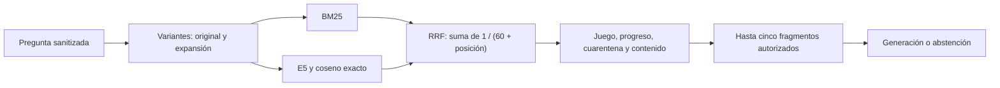

# Recuperación documental

La recuperación selecciona candidatos; los controles de acceso determinan qué evidencia puede utilizarse. El pipeline servido aplica ambas etapas antes de generar, también en el perfil base y en la búsqueda secundaria. El benchmark aislado `evaluation.retrieval` mide ranking sin esos controles y debe interpretarse por separado.

| Variante | Función |
| --- | --- |
| `bm25` | Coincidencia léxica y términos exactos |
| `dense` | Similitud mediante embeddings |
| `hybrid` | Fusión de posiciones BM25 y E5 con RRF |

La configuración servida utiliza chunking estructural, expansión por glosario y ortografía, alias de ubicación y fusión plana de rankings. Chroma persiste vectores y metadatos; la búsqueda densa utilizada calcula similitud exacta sobre los vectores cargados. La profundidad de cada lista RRF se mantiene estable para que pedir más candidatos al pipeline no cambie silenciosamente los primeros resultados.

Los experimentos históricos de [results.md](../evaluation/results.md) comparan bancos y variantes identificados. Las cifras del subconjunto inicial del curso no deben mezclarse con el banco principal posterior de 54 casos. El código de reranking y segmentación por filas se conserva para comparar, aunque esas variantes no se activen por defecto.

## Decisiones y límites

BM25 ayuda con nombres, coordenadas y códigos; los embeddings ayudan con paráfrasis. La fusión no resuelve permisos, mezcla de quests ni la suficiencia factual de una respuesta. Esas dimensiones requieren metadatos, filtros y evaluación semántica.

El contenido adicional se incorpora solo según la configuración efectiva y vuelve a pasar por acceso. Las fuentes de franquicia permanecen separadas por defecto. La interfaz muestra el contexto final de `/ask`; una búsqueda nueva no debe utilizarse como sustituto de esa evidencia.

- [BM25](bm25.md): tokenización y representación.
- [Semántica e híbrida](semantic.md): modelos, índices y fusión.
- [Expansión](query-expansion.md): glosarios y límites de generalización.
- [Métricas](../evaluation/metrics.md): unidades de relevancia, cobertura y ruido.
