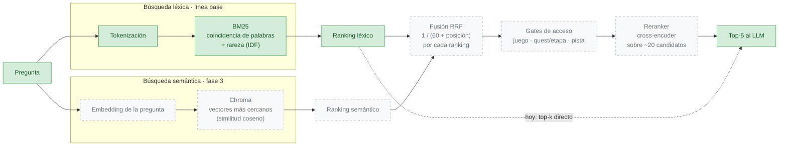

# Recuperación

La recuperación (*Retrieval*) es la fase del RAG que elige qué fragmentos recibe el LLM. Si la evidencia no se recupera, el LLM no puede usarla: solo puede abstenerse o inventar.

| Documento | Contenido |
| --- | --- |
| [bm25.md](bm25.md) | Búsqueda léxica: tokenización, qué se indexa, ablación |
| Resultados | [evaluation/results.md](../evaluation/results.md) |

## Estrategia: de léxica a híbrida

**Hoy (línea base):** solo BM25. El ranking léxico pasa directo al top-k (flecha punteada).

**Fase 3:**
- se agrega la búsqueda semántica;
- los dos rankings se fusionan con **Reciprocal Rank Fusion**, que usa la posición y no el puntaje, porque BM25 y la similitud coseno están en escalas distintas;
- se aplican los gates de acceso;
- un reranker reordena los mejores candidatos.

## Por qué combinar las dos búsquedas

| | Léxica (BM25) | Semántica (embeddings) |
| --- | --- | --- |
| Compara | Palabras de la pregunta con las del fragmento | Vectores que representan el significado |
| Fuerte en | Identificadores y nombres exactos: "Level-4", "D-4", "Gleeok" | Paráfrasis y sinónimos: "sail across the sea" ≈ "cross lakes and oceans" |
| Débil en | Sinónimos y formas de palabra ("swings" ≠ "swing") | Identificadores raros; conceptos cercanos pero incorrectos |
| Fallos medidos en la línea base | `paraphrase_01`, `direct_01` (rank 4) | Se medirá en la fase 3 |

Los fallos de una cubren los de la otra. La evaluación de la fase 3 compara **solo BM25, solo semántica e híbrida** por categoría de pregunta, para mostrar en qué tipo de pregunta gana cada una ([evaluation/metrics.md](../evaluation/metrics.md)).

Hay fallos que **no** resuelve ninguna búsqueda: la mezcla de Quest 1 y Quest 2 se corrige con el filtro de quest (gate G2), no con un mejor ranking ([evaluation/results.md](../evaluation/results.md)).
