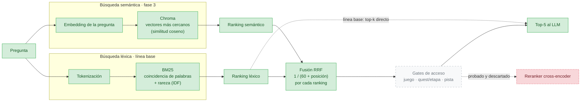

# Recuperación

La recuperación (*Retrieval*) es la fase del RAG que elige qué fragmentos recibe el LLM. Si la evidencia no se recupera, el LLM no puede usarla: solo puede abstenerse o inventar.

| Documento | Contenido |
| --- | --- |
| [bm25.md](bm25.md) | Búsqueda léxica: tokenización, qué se indexa, ablación |
| [semantic.md](semantic.md) | Búsqueda semántica (modelos, prefijos, Chroma) y fusión híbrida RRF |
| [query-expansion.md](query-expansion.md) | Transformación de consultas: corrección ortográfica, glosario del juego y multi-consulta |
| Resultados | [evaluation/results.md](../evaluation/results.md) |

## Estrategia: de léxica a híbrida

**Implementado:**
- **Las tres variantes**, seleccionables con `--retriever` o desde la fábrica de recuperadores:
  - `bm25` (línea base: el ranking léxico va directo al top-k);
  - `dense` (solo semántica);
  - `hybrid`: los dos rankings se fusionan con **Reciprocal Rank Fusion**, que usa la posición y no el puntaje, porque BM25 y la similitud coseno están en escalas distintas.
- **Comparación medida** en [evaluation/results.md](../evaluation/results.md).

**Pendiente:** los gates de acceso (otro integrante), que pueden usar los metadatos que ya están en Chroma.

**Configuración servida:** multi-consulta (ortografía + glosario) sobre la híbrida (BM25 + e5, búsqueda semántica exacta) con chunking estructural y fusión RRF plana de las 4 listas ([ADR-0009](../architecture/decisions/0009-phase3-retrieval-config.md), [ADR-0010](../architecture/decisions/0010-query-expansion.md), [ADR-0011](../architecture/decisions/0011-flat-fusion-exact-dense.md)). El índice incluye alias de ubicación ("Level 3 · first quest") y BM25 usa tokens de frase palabra + número ([ADR-0012](../architecture/decisions/0012-location-aliases-phrase-tokens.md)). Recall@5: curso 0.94, preguntas del equipo 0.88, total 0.94.

**Probadas y descartadas** (código disponible para comparaciones): reranker cross-encoder (`--reranker`) y chunking por fila (`--chunker rows`).

## Por qué combinar las dos búsquedas

| | Léxica (BM25) | Semántica (embeddings) |
| --- | --- | --- |
| Compara | Palabras de la pregunta con las del fragmento | Vectores que representan el significado |
| Fuerte en | Identificadores y nombres exactos: "Level-4", "D-4", "Gleeok" | Paráfrasis y sinónimos: "sail across the sea" ≈ "cross lakes and oceans" |
| Débil en | Sinónimos y formas de palabra ("swings" ≠ "swing") | Identificadores raros; conceptos cercanos pero incorrectos |
| Gana en (medido) | Identificadores: `exact_02` (rank 1 contra 7 a 12), `compound_02` | Formas de palabra: `direct_01` (rank 1 contra 4); `paraphrase_02` (rank 1 contra 4, con e5) |

Los fallos de una cubren los de la otra. La evaluación de la fase 3 compara **solo BM25, solo semántica e híbrida** por categoría de pregunta, para mostrar en qué tipo de pregunta gana cada una ([evaluation/metrics.md](../evaluation/metrics.md)).

Hay fallos que **no** resuelve ninguna búsqueda: la mezcla de Quest 1 y Quest 2 se corrige con el filtro de quest (gate G2), no con un mejor ranking ([evaluation/results.md](../evaluation/results.md)).
