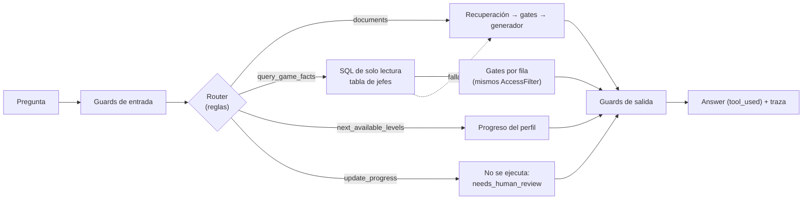

# Router y herramientas (§5.6)

Flujo de decisión (opción 2 del §5.6): un **router de intención** decide si la pregunta se responde con documentos (RAG) o con una herramienta. Decisión en el [ADR-0013](../architecture/decisions/0013-intent-router-and-tools.md).

## Por qué hace falta (no es un agente decorativo)

| Pregunta | Con solo RAG | Con la herramienta |
| --- | --- | --- |
| "list all the bosses in the first quest" | Parcial: la lista está repartida en varios chunks y el top-5 trae una parte | Las 9, completas, con su fuente |
| "what should I do next?" | Ningún documento la responde: depende del jugador | Niveles completados y pendientes, desde el perfil |
| "I just beat level 3" | Respondería con texto de la wiki | Detecta una **acción** y no la ejecuta sin confirmación |

## Herramientas

| Herramienta | Qué hace | Juegos |
| --- | --- | --- |
| `query_game_facts` | Tabla `bosses` (jefe, HP, daño, quest, nivel, chunk de origen), extraída de la página Bosses de la wiki; 18 filas en Zelda. Consultas parametrizadas por `quest` y `level` | Zelda (en NG no hay tabla de jefes: el router no la usa) |
| `next_available_levels` | Niveles completados y pendientes del perfil, solo con números de nivel (no revela contenido) | Solo juegos no lineales (`level_set`); validado en `games.py` |
| `update_progress` | **No se ejecuta**: responde con `needs_human_review = true` | Todos |

Solo se habilitan las herramientas listadas en `tools` de [config/games/](../../config/games/).

## Reglas del router

Explícitas y auditables. Ante la duda, el router elige `documents`.

| Ruta | Regla |
| --- | --- |
| `update_progress` | "I (just) beat/finished/completed/cleared … level/dungeon/stage/act" |
| `next_available_levels` | "what should I do next", "which levels can I…", "next level/dungeon", "my progress" |
| `query_game_facts` | Menciona "boss(es)" + "who/which/what/list/all/every" y **no** dice "how": "how do I defeat the boss" es una pregunta de estrategia y va al RAG |
| `documents` | Todo lo demás |

**Parámetros:** el nivel sale de "level N", "Level-N" o "dungeon N", y la quest de "first/1st quest" o "quest 1". Si la pregunta no dice la quest, se usa la del perfil.

## Controles (§5.8)

- **Alcance:** no hay SQL libre, solo consultas predefinidas con parámetros; `PRAGMA query_only` (solo lectura); máximo 50 filas.
- **Parámetros:** se validan contra la configuración del juego. "level 15" no ejecuta la consulta y responde que no existe (`status: invalid_params`).
- **Spoilers:** cada fila se evalúa con los **mismos `AccessFilter`** del pipeline, como si fuera un chunk ubicado en su (quest, nivel). Cuando se implementen G2/G3, los jefes de niveles no alcanzados se ocultan sin tocar la herramienta, y la respuesta dice cuántos quedaron ocultos.
- **Degradación:** si la herramienta falla, la pregunta sigue por el RAG (`status: degraded` en la traza).
- **Acciones críticas:** `update_progress` requiere confirmación humana.
- **Guards:** los de entrada corren **antes** del router, y los de salida (citas) también se aplican a las respuestas de las herramientas.

## Traza

`route`, `route_reason` y `tool` (`name`, `params`, `status`, `rows`, `blocked_rows`, …). Las respuestas llevan `tool_used` (§11).

## Pruebas (§8, casos de herramientas)

[tests/test_tools.py](../../tests/test_tools.py):

| Caso del §8 | Test |
| --- | --- |
| Ejecución nominal | Lista de jefes con cita; pasa `CitationGuard` |
| Selección errónea de herramienta | Ninguna de las 39 preguntas del banco va a una herramienta; "how do I defeat the boss" va al RAG; una herramienta no habilitada en la config no se usa |
| Parámetros fuera de rango | "level 15" y "third quest": no se ejecuta, `invalid_params` |
| Acción con confirmación humana | "I just beat level 3": `needs_human_review`, `executed: false` |
| Degradación controlada | La herramienta lanza una excepción y la respuesta sale del RAG |

Además: base de datos de solo lectura, gates aplicados por fila, guards de entrada antes del router.
